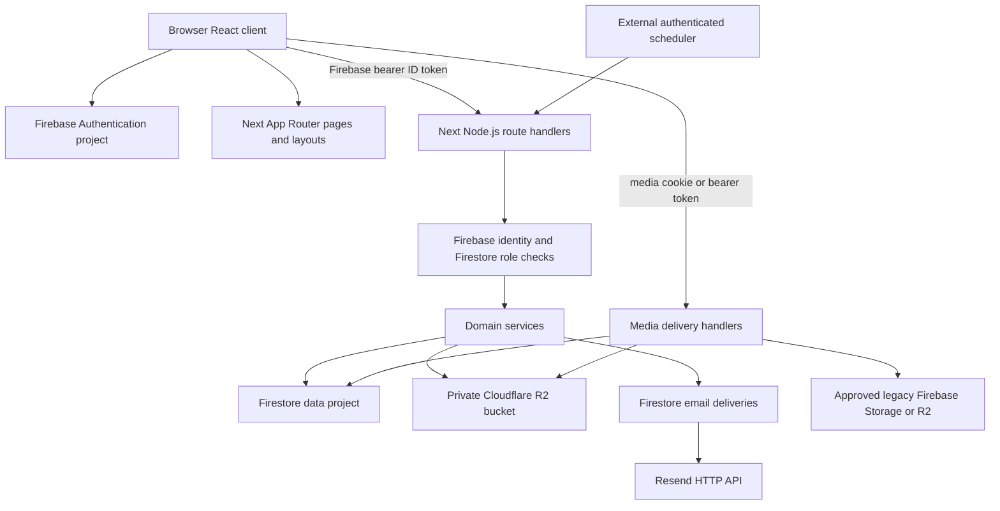

# ARCHITECTURE

> Source audit: 2026-11-06 (Asia/Calcutta). Branch `main`, commit `fa98b7e0e53d29053365be4c1a1b8230a313f686`. Static inspection only; no production database access, external service health checks, browser tests, migrations, push or deployment. ?Implemented? means a source-complete path with identifiable validation and authorization; it does not certify successful runtime operation. Historical reports are secondary evidence only.

## Application boundary

## Directory map

- `src/app`: App Router entry points, layouts, API route files, error/not-found and informational pages.
- `src/features`: domain UI: account, auth, admin, properties, services, enquiries, negotiations, visits, public landing/search/navigation/footer.
- `src/ui`: reusable Radix/shadcn style controls. `src/components`: application shell, guards, PWA, media and shared forms.
- `src/contexts`: Firebase auth/profile/media lifecycle and public search state. `src/hooks`: query hooks and view utilities.
- `src/services`: browser API wrappers. `src/lib`: validation, domain policies, state machines, navigation and refresh conventions.
- `src/lib/server/services`: server business logic; `src/lib/server`: identity, Firestore/Admin, HTTP, permissions, R2, file projections and metrics.
- `public`: brand/static assets, manifest, icons, service worker and offline page. `scripts`: audits, fixture management, legacy wiring, live verification. `tests`: unit/contracts and browser suites.
- Root historical reports and audit directories describe prior work; `.history`, browser results, `.cache`, `.next` and `node_modules` are not active source modules. Package/lock/config and tracked files were inventoried; customer-bearing logs and environment values were not copied into this knowledge base.

## Frontend composition and routing

`src/app/layout.tsx` wraps children with Suspense, `src/app/providers.tsx` and `src/components/ApplicationShell.tsx`. Providers supply a QueryClient (60-second stale time, retries disabled by default), AuthContext, SearchContext, tooltips and toasts. The application shell owns site chrome. Pages generally delegate to feature components; business interactions run in client components.

The `(protected)` route group uses its layout and `src/components/RouteGuard.tsx`; it does not create a URL segment. `/admin` has a dedicated guarded layout. The guard is a client UX boundary, not server authorization. No checked-in middleware/proxy route guard was found. API handlers enforce their own identity and object access. Dynamic route context uses awaited Promise params, consistent with the installed Next documentation at `node_modules/next/dist/docs/01-app/03-api-reference/03-file-conventions/route.md`.

## State and invalidation

TanStack Query caches property/user data. Query keys include UID for important protected resources; `src/contexts/AuthContext.tsx` clears the query cache when identity changes. Local component state manages drafts, tabs, dialogs and upload state. `src/contexts/SearchContext.tsx` carries search state. `src/lib/data-refresh.ts` maps successful API mutations to affected domains and broadcasts refresh events; mounted consumers invalidate queries/refetch. This is not a server push or Firestore realtime listener system.

`src/lib/api-client.ts` waits for Firebase auth readiness, gets current ID token per same-origin `/api` call, and prevents a request started under one UID from silently using another. External URL requests do not receive the injected bearer token. `loadAuthProfile` coalesces concurrent checks and retries some 500/503 responses once, but not quota exhaustion.

## Backend and service dependencies

Thin `src/app/api/**/route.ts` modules bind methods to services and `handle` wrappers; unsupported exports return 405. Most are force-dynamic Node handlers. Shared `src/lib/server/http.ts` formats responses, applies file projection and maps access/config/dependency failures. Legacy collection/trailing slash behavior is preserved by native wrappers, including redirects and a compatibility health response on some upload/agreement trailing-slash requests.

`properties.ts` depends on users, listing/category/validation policies, media, relationships, notifications and email. `tenants.ts`, `agreements.ts` and `owner-verification.ts` update property relationships and parallel tenant documents. `property-hub.ts` aggregates lifecycle, rent, files, maintenance, offers and visits. `notifications.ts` is both a public enquiry intake and an authenticated operational inbox; `enquiries.ts` adds private broker tracking in its own collection. `negotiations.ts` is independent from enquiry assignment. `migration-remainder.ts` contains active login, service catalogue/requests, reports/reviews and site settings despite its historical name.

## Data, uploads and email

Firebase Admin data access is server-only, with string collection constants and additional literal collection names. Legacy generated schemas control nested encoding, omitempty behavior, nil arrays and date serialization; native additive fields are handled alongside them. Types are not enforced by Firestore itself. Dates mix Firestore Timestamp, JavaScript Date and ISO/date-only strings. Money mixes strings in rental/property models with numeric negotiated amounts.

`src/lib/server/services/media.ts` writes durable upload intent, uploads at `managed/{id}` to a separate private bucket, then moves metadata through pending/attached states. Transactions bind objects to allowlisted fields and property IDs. Downloads re-read bindings and property permissions; public delivery is restricted to approved available cover images or site banners. `src/lib/server/file-projection.ts` projects legacy references into authenticated proxy URLs. Cleanup has leases/tombstones and an admin reconciliation API. Legacy deletion records approval-required cleanup rather than deleting arbitrary external URLs.

`src/lib/server/services/transactional-email.ts` supports atomic outbox staging and post-response `after()` dispatch. Other callers enqueue after business commits with best-effort catches; delivery is not universally atomic with business data. Provider attempts use leases, deterministic idempotency and a maximum of five attempts; older ambiguous deliveries need reconciliation. Resend acceptance is not inbox delivery. No provider webhook route exists. See API and deployment references for authorized retries and reminder cursors.

## Complete page route map

- `/(protected)/add-property` ? `src/app/(protected)/add-property/page.tsx` (route group omitted from actual URL)
- `/(protected)/add-tenant/[propertyId]` ? `src/app/(protected)/add-tenant/[propertyId]/page.tsx` (route group omitted from actual URL)
- `/(protected)/archived-properties` ? `src/app/(protected)/archived-properties/page.tsx` (route group omitted from actual URL)
- `/(protected)/attach-documents/[propertyId]` ? `src/app/(protected)/attach-documents/[propertyId]/page.tsx` (route group omitted from actual URL)
- `/(protected)/edit-property/[propertyId]` ? `src/app/(protected)/edit-property/[propertyId]/page.tsx` (route group omitted from actual URL)
- `/(protected)/inspection-report/[propertyId]` ? `src/app/(protected)/inspection-report/[propertyId]/page.tsx` (route group omitted from actual URL)
- `/(protected)/legal-services/[propertyId]` ? `src/app/(protected)/legal-services/[propertyId]/page.tsx` (route group omitted from actual URL)
- `/(protected)/manage-property` ? `src/app/(protected)/manage-property/page.tsx` (route group omitted from actual URL)
- `/(protected)/manage-property/[propertyId]` ? `src/app/(protected)/manage-property/[propertyId]/page.tsx` (route group omitted from actual URL)
- `/(protected)/my-account` ? `src/app/(protected)/my-account/page.tsx` (route group omitted from actual URL)
- `/(protected)/other-services/[propertyId]` ? `src/app/(protected)/other-services/[propertyId]/page.tsx` (route group omitted from actual URL)
- `/(protected)/renew-agreement/[propertyId]` ? `src/app/(protected)/renew-agreement/[propertyId]/page.tsx` (route group omitted from actual URL)
- `/(protected)/request-services/[propertyId]` ? `src/app/(protected)/request-services/[propertyId]/page.tsx` (route group omitted from actual URL)
- `/(protected)/review/[propertyId]` ? `src/app/(protected)/review/[propertyId]/page.tsx` (route group omitted from actual URL)
- `/(protected)/select-property-type` ? `src/app/(protected)/select-property-type/page.tsx` (route group omitted from actual URL)
- `/(protected)/tenant-property` ? `src/app/(protected)/tenant-property/page.tsx` (route group omitted from actual URL)
- `/(protected)/terminate-agreement/[propertyId]` ? `src/app/(protected)/terminate-agreement/[propertyId]/page.tsx` (route group omitted from actual URL)
- `/(protected)/visit-planner` ? `src/app/(protected)/visit-planner/page.tsx` (route group omitted from actual URL)
- `/about` ? `src/app/about/page.tsx`
- `/admin` ? `src/app/admin/page.tsx`
- `/auth` ? `src/app/auth/page.tsx`
- `/blog` ? `src/app/blog/page.tsx`
- `/buy` ? `src/app/buy/page.tsx`
- `/contact` ? `src/app/contact/page.tsx`
- `/faq` ? `src/app/faq/page.tsx`
- `/` ? `src/app/page.tsx`
- `/privacy` ? `src/app/privacy/page.tsx`
- `/properties` ? `src/app/properties/page.tsx`
- `/property/[propertyId]` ? `src/app/property/[propertyId]/page.tsx`
- `/rent` ? `src/app/rent/page.tsx`
- `/search` ? `src/app/search/page.tsx`
- `/sell` ? `src/app/sell/page.tsx`
- `/services` ? `src/app/services/page.tsx`
- `/support` ? `src/app/support/page.tsx`
- `/terms` ? `src/app/terms/page.tsx`
