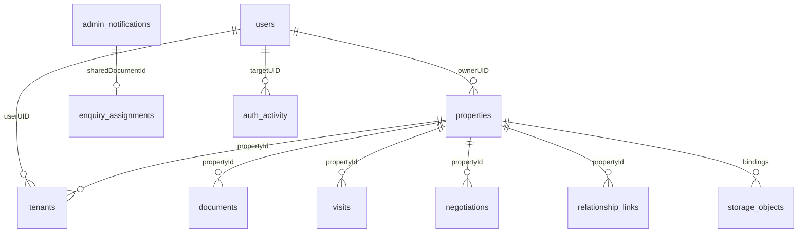

# DATABASE SCHEMA

> Current mobile policy: schema-2 legacy reservations supersede earlier all-conflicts-must-be-fixed activation requirements. Unique contacts are reserved; duplicate numbers are ownerless blocked claims; missing/invalid profiles are locked in mobile_number_registry_accounts. Historical users stay unchanged. Three private registry collections make 25 total source collections; no new API. [Current design, tests and controlled runbook](../MOBILE_LEGACY_RESERVATIONS.md).

> Implementation update (2026-11-06): K05 has a tested transaction-backed mobile registry implementation on `fix/mobile-number-uniqueness`, but production reconciliation/backfill/activation is pending. The historical statements below describe the audited starting commit. Current behavior, two new server-only collections (24 total), fail-closed rollout requirements and test limits supersede those mobile-specific statements: [Mobile uniqueness implementation and rollout](../MOBILE_NUMBER_UNIQUENESS.md).

> Source audit: 2026-11-06 (Asia/Calcutta). Branch `main`, commit `fa98b7e0e53d29053365be4c1a1b8230a313f686`. Static inspection only; no production database access, external service health checks, browser tests, migrations, push or deployment. ?Implemented? means a source-complete path with identifiable validation and authorization; it does not certify successful runtime operation. Historical reports are secondary evidence only.

## Scope and interpretation

**22 code-confirmed top-level Firestore collections**: 13 exported in COLLECTIONS plus 9 additional collections used through literals/constants. No subcollection usage was found in active source. This is a source-derived flexible schema, not a live data export or a deployed validation contract. No records or personal data were read. No collections named owners, brokers, enquiries, rent_payments or agreements are invented: those concepts use the records described below.

`src/lib/server/firestore.ts` maps base names. `src/lib/server/services/go-contracts.ts` is a generated legacy schema; `contracts.ts` maps JSON names to persisted field names and controls omitted values. Request/response models are not automatically collections. New native fields coexist with the generated contract. Missing fields, legacy nil arrays and malformed records are handled differently by each service; `getRecords` often skips records that fail model decoding.

Type convention: string = string (including many money/date-only values); int/float64 = number; bool = boolean; time.Time = persisted Date/Firestore Timestamp, JSON ISO string; interface{} = dynamic value; [] = array (often null for absent legacy arrays); * = nullable nested value. Fields in tables are confirmed schema declarations, not a guarantee that all documents contain them. Store-omit means encoder may omit an empty field. Readers can overlay defaults and native code can merge additional fields.

## Collections and operations

### C01. `users`

- Identity/relationships/operations: UID shared with Firebase Auth; GET self/admin, global list/admin search, onboarding/create and profile updates.
- Model: `User` (full fields below).
- Evidence: `src/lib/server/services/users.ts`, `src/lib/server/services/account.ts`, `src/lib/server/auth.ts`, `src/lib/server/services/auth-activity.ts`.

### C02. `properties`

- Identity/relationships/operations: Generated listing ID (four letters/four digits with collision fallback); ownerUID, submittedByUID and tenants[].userUID connect users. Public eligibility query, own/submitted equality queries, member reads, transactional create/update/moderation.
- Model: `Property` (full fields below).
- Evidence: `src/lib/server/services/properties.ts`, `src/lib/server/services/property-hub.ts`, `src/lib/server/services/agreements.ts`, `src/lib/server/services/owner-verification.ts`.

### C03. `negotiations`

- Identity/relationships/operations: Auto-ID; propertyId and ownerUID/customerUID/brokerUID participants. Create/read scoped list; transaction versioned state changes.
- Model: Native/dynamic fields described below.
- Evidence: `src/lib/server/services/negotiations.ts`.

### C04. `tenants`

- Identity/relationships/operations: ID mirrored in properties.tenants[].id. propertyId, ownerUID and optional linked userUID; property scoped active reads; transactional add/update/deactivate and synchronized property writes.
- Model: `Tenant` (full fields below).
- Evidence: `src/lib/server/services/tenants.ts`, `src/lib/server/services/agreements.ts`, `src/lib/server/services/relationship-links.ts`.

### C05. `visits`

- Identity/relationships/operations: Generated reference; userId requester, optional propertyId. Self/admin list/detail, create/update/delete, reminder leases.
- Model: `Visit` (full fields below).
- Evidence: `src/lib/server/services/visits.ts`, `src/lib/server/services/reminders.ts`.

### C06. `services`

- Identity/relationships/operations: Service catalogue ID; read catalogue, merged with hardcoded active defaults; no CRUD admin endpoint.
- Model: `Service` (full fields below).
- Evidence: `src/lib/server/services/migration-remainder.ts`.

### C07. `service_requests`

- Identity/relationships/operations: UUID; userUID requester, propertyId optional, serviceId catalogue; member/self/admin queries, admin status/archive resolution with media binding transaction.
- Model: `ServiceRequest` (full fields below).
- Evidence: `src/lib/server/services/migration-remainder.ts`.

### C08. `documents`

- Identity/relationships/operations: UUID or SHA256 UID/property/idempotency key; propertyId, userId uploader; property/type list, member detail, admin review, staged deletion.
- Model: `Document` (full fields below).
- Evidence: `src/lib/server/services/documents.ts`, `src/lib/server/services/media.ts`.

### C09. `reviews`

- Identity/relationships/operations: UUID; propertyId, reviewerId, ownerId, tenantId; property membership read, relationship-derived reviewer writes.
- Model: `Review` (full fields below).
- Evidence: `src/lib/server/services/migration-remainder.ts`.

### C10. `inspection_reports`

- Identity/relationships/operations: UUID; propertyId and userId; property/user filtered createdAt descending reads, member create.
- Model: `InspectionReport` (full fields below).
- Evidence: `src/lib/server/services/migration-remainder.ts`.

### C11. `admin_notifications`

- Identity/relationships/operations: UUID or deterministic event hash; propertyId, userId, ownerId and optional relatedId. Enquiry/request intake, scoped/global read, admin remark/archive/delete.
- Model: `AdminNotification` (full fields below).
- Evidence: `src/lib/server/services/notifications.ts`, `src/lib/server/services/property-effects.ts`, `src/lib/server/services/enquiry-protection.ts`.

### C12. `email_deliveries`

- Identity/relationships/operations: SHA256 idempotency key; optional recipientUID/propertyId/recordId/invitationClaimId; transactional outbox, leased provider attempts, paged admin reads/retry.
- Model: Native/dynamic fields described below.
- Evidence: `src/lib/server/services/transactional-email.ts`, `src/lib/server/services/relationship-invitation-email.ts`.

### C13. `siteSettings`

- Identity/relationships/operations: Singleton main_settings; public reads/defaults and admin updates; banner binding metadata.
- Model: `SiteSettings` (full fields below).
- Evidence: `src/lib/server/services/migration-remainder.ts`, `src/lib/server/services/properties.ts`.

### C14. `auth_activity`

- Identity/relationships/operations: UUID; actorUID and targetUID reference users/Auth. Record supported events and query by targetUID; trims oldest entries beyond 100 after each event.
- Model: Native/dynamic fields described below.
- Evidence: `src/lib/server/services/auth-activity.ts`, `src/lib/server/services/users.ts`, `src/lib/server/services/account.ts`.

### C15. `enquiry_assignments`

- Identity/relationships/operations: Document ID equals admin_notifications enquiry ID. brokerUID references agent; transactional status/assignment changes with actor revalidation.
- Model: Native/dynamic fields described below.
- Evidence: `src/lib/server/services/enquiries.ts`.

### C16. `relationship_links`

- Identity/relationships/operations: Deterministic SHA256 relationship/property/tenant/contact identity. Links propertyId/tenantId/ownerUID/candidateUID; discovery queries, authorized state refresh and transactional confirmations.
- Model: Native/dynamic fields described below.
- Evidence: `src/lib/server/services/relationship-links.ts`, `src/lib/server/services/owner-verification.ts`.

### C17. `relationship_link_limits`

- Identity/relationships/operations: Hashed UID/action/minute key; count increments and expiresAt set in transaction. No user payload beyond opaque ID.
- Model: Native/dynamic fields described below.
- Evidence: `src/lib/server/services/relationship-links.ts`.

### C18. `email_invitation_limits`

- Identity/relationships/operations: Hashed actor/recipient/time-window quota key; count, expiresAt updated transactionally with invitation outbox decisions.
- Model: Native/dynamic fields described below.
- Evidence: `src/lib/server/services/relationship-invitation-email.ts`.

### C19. `enquiry_controls`

- Identity/relationships/operations: Hash-based window/replay records. Counters and replay records committed atomically with notification and optional email events.
- Model: Native/dynamic fields described below.
- Evidence: `src/lib/server/services/enquiry-protection.ts`.

### C20. `property_submissions`

- Identity/relationships/operations: Canonical request SHA256 fingerprint; maps propertyId, submitterUID, createdAt. Read dedupe before upload and create receipt inside property transaction.
- Model: Native/dynamic fields described below.
- Evidence: `src/lib/server/services/properties.ts`.

### C21. `storage_objects`

- Identity/relationships/operations: UUID; metadata for exact managed/{id} key, uploadedBy UID and property/field bindings. Leased upload/attach/deletion state; admin reconciliation page.
- Model: Native/dynamic fields described below.
- Evidence: `src/lib/server/services/media.ts`.

### C22. `legacy_storage_cleanup`

- Identity/relationships/operations: Deleted document ID; records historical fileUrl and approval-required cleanup intent while removing metadata in transaction.
- Model: Native/dynamic fields described below.
- Evidence: `src/lib/server/services/documents.ts`.

## Native additions and dynamic document structures

All following fields are confirmed by literal reads/writes or exported interfaces; object members can be optional and history payloads vary by action. No live backfill completeness is asserted.

| Collection | Confirmed native fields and types |
| --- | --- |
| users | isActive:boolean; emailVerified:boolean; accountStatus:string; providerIds:string[]; createdAt/updatedAt/lastSuccessfulSignInAt: timestamp or legacy string; agencyName/agencyPhone/agencyWebsite/bio:string; notificationPreferences:{productUpdates:boolean,activitySummaries:boolean,security:boolean}; legacy rentedPropertyId/rentedPropertyOwnerId/rentedPropertyOwnerName:string (best-effort metadata, not membership authority) |
| properties | propertyCategory/buildingName/plotArea/areaUnit/carpetAreaUnit/constructedAreaUnit/plotAreaUnit/expectedRent/structure:string; createdAs:'owner' or 'tenant' where supplied; submittedByUID/submittingAgentUID:string for agent workflow; reportedOwner:contact object (name/company/contact/phoneE164); ownershipVerification:'pending','verified','rejected'; ownershipVerificationVersion:number; reviewer UID/reviewedAt/reason; ownershipVerificationAudit:{actorUID,ownerUID,evidenceDocumentId,reviewNote,verifiedAt}; ownershipVerificationHistory:decision[]; moderationStatus:'pending_review','approved','rejected','changes_requested'; moderationRevision:number; moderationSubmittedAt/moderationReviewedAt timestamps; moderationReviewerUID/moderationReason:string; moderationHistory:event[]; tenancyRevision:number; createdByUID/adminCreatedForUID:string; relationshipHistory:event[] |
| properties (operations) | agreementStatus:string; agreementRequest:{id,kind,status,requestedBy,requestedAt,terms/proposedTerms,resolvedAt,resolvedBy,noticePeriod,noticeStartDate,terminationDate}; agreementHistory:event[] with previousTerms/previousTenants; noticeStartDate/anticipatedTerminationDate/terminationDate: string or timestamp depending path; nextAgreementDraft:validated object or null; rentLedger:map keyed YYYY-MM with {month,expectedRent:number,dueDate:string,status:'due' or 'paid',receiptId,notes,actorUID,updatedAt}; rentLedgerVersion:number; rentLedgerHistory:event[]; internalNotes:{id,text,actorUID,at}[]; timezone:string when present; isRented:boolean |
| tenants | phoneE164:string; linkConfirmationRequired:boolean; linkedAt:timestamp; linkedByUID:string; assignedByUID/assignmentSource/removedByUID:string; nextAgreementDraft:object or null; agreementVersion/rentSchedule read dynamically for reminders |
| visits | managementVersion:number; visitAdminHistory:event[]; reminderDelivery:{generation,status,lease,leaseUntil,firstAttemptAt,events:email-event[]}; notifiedAt:timestamp or null |
| negotiations | id/propertyId/propertyTitle/ownerUID/customerUID/brokerUID:string; originalAskingPrice/customerOffer:number; brokerProposedAmount/ownerCounterAmount/ownerApprovedAmount/finalAgreedAmount:number or null; status:'offered','proposed','countered','owner_approved','accepted','rejected','withdrawn','completed'; version:number; history:{action,actorUID,amount:number or null,at:ISO string}[]; createdAt/updatedAt:ISO string |
| documents | contentType:string; size:number bytes; idempotencyKey:string; financialYear/period/amount/receiptDate:string; status:'submitted','verified','rejected'; adminComment:string; statusHistory:{status,comment,actorUID,at}[]; deletionStatus:'pending' |
| service_requests | history:{status,action?,actorUID,comment?,at}[]; isArchived:boolean; completedAt:timestamp; adminNotes/resolutionReport/adminImage:string (also see model) |
| admin_notifications | relatedId:string; resolvedAt:timestamp; archiveHistory:event[]; enquiry source fields and contacts are in generated model. Broker tracking is deliberately separate. |
| enquiry_assignments | notificationId/brokerUID/brokerName/status:string (new/contacted/visit_scheduled/negotiating/closed_won/closed_lost); version:number; history:{action,actorUID,at,notes,previousBrokerUID,brokerUID,previousStatus,status}[]; updatedAt:timestamp (no createdAt write in this service) |
| relationship_links | id/propertyId/relationship/tenantId/contactE164/candidateUID/ownerUID/createdByUID:string; recipientEmailNormalized and identityMethod:'email' optional; status canonical states below; version:number; createdAt/updatedAt/expiresAt timestamps; authorizedByUID/authorizedCandidateUID/confirmedByUID/invitationAuthorizedByUID/reviewerUID/approvedOwnerUID:string; linkedAt/confirmedAt/ownerApprovedAt/reviewedAt/rejectedAt/expiredAt/identityUpgradedAt/emailVerifiedAt/phoneVerifiedAt timestamps; verificationVersion:number |
| relationship_link_limits | count:number; expiresAt:timestamp |
| email_invitation_limits | count:number; expiresAt:timestamp |
| enquiry_controls | Counter variant {count:number,expiresAt:timestamp,ttlAt:timestamp}; replay variant {fingerprint:string,notificationId:string,expiresAt:epoch milliseconds,ttlAt:timestamp} |
| property_submissions | propertyId:string; submitterUID:string; createdAt:timestamp; no code-enforced expiry |
| storage_objects | id/bucket/key/uploadedBy/propertyId/filename/contentType/status:string; size:number; privateOnly:boolean; bindings:{collection,id,propertyId,field}[]; createdAt/updatedAt timestamps; cleanupLease:string; leaseUntil:epoch ms; deleteDocumentId:string; lastError:string |
| legacy_storage_cleanup | documentId/propertyId/fileUrl/requestedBy:string; status:'approval_required'; createdAt:timestamp |
| auth_activity | id/eventType/actorUID/targetUID:string; context:allowlisted providerIds/emailVerified/previousRole/role/previousStatus/status/source; createdAt:timestamp |
| email_deliveries | id/eventType/eventId/recipientRole/recipientEmail/subject/html/text/templateId/idempotencyKey/status:string; recipientUID/propertyId/recordId/invitationClaimId/tenancyId/rentPeriod/agreementVersion/scheduledFor/reminderDueDate/reminderAmount optional strings; templateVersion/retryCount/reminderOffset:number; deliveryLease:string; createdAt/updatedAt/sentAt/lastAttemptAt/firstAttemptAt/nextRetryAt/deliveryLeaseUntil timestamps; errorSummary/failureCategory/providerMessageId/providerErrorCode:string; providerStatus:number |

Relationship canonical states are verification_required, pending_owner_authorization, pending_tenant_acceptance, pending_admin_verification, linked, rejected, expired (`src/lib/relationship-link-state.ts`). Historical awaiting_* states are normalized at read/authorized transition time; no startup migration.

Managed storage states include uploading, pending, attached, cleanup_pending, deleting and deleted. Bindings must match a current allowlisted business-record field; metadata alone does not authorize a download.

## Relationships and consistency

These are logical references, not enforced foreign keys. Tenant records duplicate property-embedded rows. Property writes, tenant synchronization, agreement changes, admin tenancy and link confirmation use transactions to maintain both. Owner verification updates property owner and all matching tenant owner references. UIDs must not be reassigned via ordinary form input. A linked tenancy must match current active state; pending claims cannot grant membership.

Money remains strings in legacy property/tenant schemas; negotiations and ledger expectedRent are numeric. Do not perform lexical comparisons for amounts. Legacy calendar dates and full timestamps have different meanings. Reminder code applies a valid property timezone or Asia/Kolkata fallback; visit presentation uses IST. Retain historical snapshots when changing terms, and never infer payment from a due date or elapsed visit time.

## Queries and index requirements

No checked-in firestore.indexes.json or rules file was found. The following are source query shapes and likely composite-index candidates, not proof of deployed indexes. Firestore's actual requirements depend on index configuration; inspect console/emulator errors in separately authorized work.

| Module | Query pattern and index consideration |
| --- | --- |
| Public properties/search | isActive==true AND moderationStatus==approved; optional listingType/projectCondition. Composite/merged equality indexes may be needed. No cursor/limit. |
| Own/agent property lists | ownerUID==UID; submittedByUID==UID; tenant lookup currently scans all properties. |
| Tenants | propertyId==ID AND isActive==true; propertyId equality for synchronization. |
| Relationship claims | recipientEmailNormalized/contactE164 + status, capped 101; candidateUID/ownerUID + status, capped 100 per state; propertyId + relationship for ownership review. |
| Inspections | propertyId or userId equality + createdAt descending (composite candidates). |
| Documents | propertyId equality plus optional documentType equality; sorts createdAt locally. |
| Negotiations | optional propertyId plus ownerUID/customerUID/brokerUID equality; three participant queries, each limit 100; admin limit 100; sort locally. |
| Visits | userId equality then sort/filter locally; admin optional propertyId equality or all; reminder visitDate range now..+7 days ordered ascending limit 1000. |
| Email history | createdAt descending (or __name__ descending legacy mode), pageSize+1 capped 201; snapshot cursor; filters applied after page retrieval. |
| Hub | all properties before membership filtering; related propertyId IN chunks of 30; optional detail queries by propertyId; administrator enquiry pipeline adds notification reads. |
| Auth activity | targetUID equality; full matching snapshot then sort/trim locally. |
| Property reminders | isActive==true, ordered __name__, 250 per page; signed stateful continuation returned. |

TTL fields are written for enquiry/link/invitation controls, but TTL policies are external unknowns. Expiry logic does not prove that old control documents are physically deleted. No general schema migration or automatic index creation is performed.

## Transactions and excessive-read hotspots

Transactions coordinate property submission receipts, property/media/tenant/link changes, enquiry quota+replay+notification+email intent, tenant link confirmations, owner verification, moderation, agreement actions, ledger versions, assignment versions, delivery leases and cleanup leases. External R2/Resend/Firebase operations cannot share a Firestore ACID transaction; ordering/durable intent matters. Some Firebase identity lookups occur inside transaction callbacks and may repeat on transaction retry.

Full scans occur in tenant property matching, hub property selection, admin properties/user directory/search, and some notification/service/visit lists. Admin user listing makes a Firebase Auth getUser for every Firestore user. Admin dossiers read all properties and target activity; enquiry inbox reads tracking per notification and all matching enquiry deliveries. Relationship list executes separate queries for each canonical and legacy state, then property checks. Media delivery reads metadata plus all current bindings and membership; many images amplify reads. Auth activity cleanup queries all matching events per logged activity. Supporting-file quota computes over all property documents before save. Read metrics instrument only property_list/property_detail/delivery_page and estimate document reads; they are neither a global billing counter nor a limiter.

## User account and mobile storage detail

Firebase Auth UID is document ID and logical identity; `uid` is also stored in legacy User model. Users.email must match current verified Firebase email for protected access. users.phoneNumber is a mandatory contact stored as +91 canonical string on new creation. It is not equivalent to Auth phoneNumber or token phone_number. Tenant.phone, tenant.phoneE164, property.mobileNumber/primaryNo/ultNo/ownerPhone and notification userPhone are separate contextual copies, not global verified identity fields. Auth phone enrollment/OTP UI is absent. Phone linking requires token and current Admin account phone agreement, and verified email; email claims use current verified Firebase email and never editable profile values.

Phone uniqueness uses equality prechecks outside the UID creation transaction, so concurrency and old formatting can permit duplicates. The profile creation transaction prevents two writers creating the same UID document; it does not reserve a phone across different UIDs. There is no Firestore unique-email index. See AUTH_AND_SECURITY for account linking and role policy.

## Full persisted legacy model field dictionary

The following tables are extracted from the current generated schema, including nested models, with exact stored names/types. Native fields above are additional. Request/response-only models are intentionally excluded here and referenced by API_REFERENCE.

### Model `User`

| JSON field | Stored field | Source type | Store omit empty |
| --- | --- | --- | --- |
| `uid` | `uid` | `string` | no |
| `email` | `email` | `string` | no |
| `name` | `name` | `string` | no |
| `photoURL` | `photoURL` | `string` | no |
| `phoneNumber` | `phoneNumber` | `string` | no |
| `role` | `role` | `UserRole` | no |
| `rentedPropertyId` | `rentedPropertyId` | `string` | yes |
| `rentedPropertyOwnerId` | `rentedPropertyOwnerId` | `string` | yes |
| `rentedPropertyOwnerName` | `rentedPropertyOwnerName` | `string` | yes |
| `createdAt` | `createdAt` | `time.Time` | no |
| `updatedAt` | `updatedAt` | `time.Time` | no |
| `isActive` | `isActive` | `bool` | no |

### Model `Property`

| JSON field | Stored field | Source type | Store omit empty |
| --- | --- | --- | --- |
| `id` | `id` | `string` | no |
| `title` | `title` | `string` | no |
| `propertyType` | `propertyType` | `string` | no |
| `configuration` | `configuration` | `string` | no |
| `listingType` | `listingType` | `string` | no |
| `unitNumber` | `unitNumber` | `string` | no |
| `floor` | `floor` | `string` | no |
| `location` | `location` | `string` | no |
| `address` | `address` | `string` | no |
| `city` | `city` | `string` | no |
| `state` | `state` | `string` | no |
| `zipCode` | `zipCode` | `string` | no |
| `carpetArea` | `carpetArea` | `string` | no |
| `constructedArea` | `constructedArea` | `string` | no |
| `squareFeet` | `squareFeet` | `int` | no |
| `tenantName` | `tenantName` | `string` | no |
| `tenantEmail` | `tenantEmail` | `string` | no |
| `personName` | `personName` | `string` | no |
| `mobileNumber` | `mobileNumber` | `string` | no |
| `primaryNo` | `primaryNo` | `string` | no |
| `ultNo` | `ultNo` | `string` | no |
| `monthlyRent` | `monthlyRent` | `string` | no |
| `sellingPrice` | `sellingPrice` | `string` | no |
| `monthlyRent1stYear` | `monthlyRent1stYear` | `string` | no |
| `monthlyRent2ndYear` | `monthlyRent2ndYear` | `string` | no |
| `monthlyRent3rdYear` | `monthlyRent3rdYear` | `string` | no |
| `monthlyRent4thYear` | `monthlyRent4thYear` | `string` | no |
| `rentFromDate1` | `rentFromDate1` | `string` | no |
| `rentToDate1` | `rentToDate1` | `string` | no |
| `rentFromDate2` | `rentFromDate2` | `string` | no |
| `rentToDate2` | `rentToDate2` | `string` | no |
| `rentSchedule` | `rentSchedule` | `[]RentScheduleItem` | no |
| `paymentDueDate` | `paymentDueDate` | `string` | no |
| `escalationPercentage` | `escalationPercentage` | `string` | no |
| `escalationAmount` | `escalationAmount` | `string` | no |
| `securityDeposit` | `securityDeposit` | `string` | no |
| `agreementPeriod` | `agreementPeriod` | `string` | no |
| `agreementStartDate` | `agreementStartDate` | `string` | no |
| `agreementEndDate` | `agreementEndDate` | `string` | no |
| `noticePeriod` | `noticePeriod` | `string` | no |
| `lockInPeriod` | `lockInPeriod` | `string` | no |
| `unitCondition` | `unitCondition` | `string` | no |
| `maintenanceToBePaidBy` | `maintenanceToBePaidBy` | `string` | no |
| `projectCondition` | `projectCondition` | `string` | no |
| `internalImages` | `internalImages` | `[]string` | no |
| `possessionDate` | `possessionDate` | `string` | no |
| `rentalStatus` | `rentalStatus` | `string` | no |
| `agreementStatus` | `agreementStatus` | `string` | no |
| `anticipatedTerminationDate` | `anticipatedTerminationDate` | `string` | no |
| `furnishedChecklist` | `furnishedChecklist` | `[]FurnishedItem` | no |
| `description` | `description` | `string` | no |
| `price` | `price` | `float64` | no |
| `bedrooms` | `bedrooms` | `int` | no |
| `bathrooms` | `bathrooms` | `float64` | no |
| `images` | `images` | `[]string` | no |
| `specificComments` | `specificComments` | `string` | no |
| `tenants` | `tenants` | `[]TenantInfo` | no |
| `buyers` | `buyers` | `[]BuyerInfo` | no |
| `ownerUID` | `ownerUID` | `string` | no |
| `ownerName` | `ownerName` | `string` | no |
| `ownerEmail` | `ownerEmail` | `string` | no |
| `ownerPhone` | `ownerPhone` | `string` | no |
| `ownerRole` | `ownerRole` | `string` | no |
| `wantToSell` | `wantToSell` | `bool` | no |
| `status` | `status` | `string` | no |
| `isActive` | `isActive` | `bool` | no |
| `isSold` | `isSold` | `bool` | no |
| `createdAt` | `createdAt` | `time.Time` | no |
| `updatedAt` | `updatedAt` | `time.Time` | no |
| `isPreLeased` | `isPreLeased` | `bool` | no |
| `preLeasedType` | `preLeasedType` | `string` | no |
| `agreementTerm` | `agreementTerm` | `string` | no |
| `lockInPeriodPreLeased` | `lockInPeriodPreLeased` | `string` | no |
| `rentalIncome` | `rentalIncome` | `string` | no |
| `escalation` | `escalation` | `string` | no |
| `tenantDetails` | `tenantDetails` | `string` | no |
| `purpose` | `purpose` | `string` | no |
| `specificRequirement` | `specificRequirement` | `string` | no |

### Model `Tenant`

| JSON field | Stored field | Source type | Store omit empty |
| --- | --- | --- | --- |
| `id` | `id` | `string` | no |
| `propertyId` | `propertyId` | `string` | no |
| `ownerUID` | `ownerUID` | `string` | no |
| `firstName` | `firstName` | `string` | no |
| `lastName` | `lastName` | `string` | no |
| `email` | `email` | `string` | no |
| `phone` | `phone` | `string` | no |
| `emergencyContact` | `emergencyContact` | `string` | no |
| `userUID` | `userUID` | `string` | yes |
| `isMarried` | `isMarried` | `bool` | no |
| `spouse` | `spouse` | `*SpouseInfo` | yes |
| `leaseStartDate` | `leaseStartDate` | `string` | no |
| `leaseEndDate` | `leaseEndDate` | `string` | no |
| `monthlyRent` | `monthlyRent` | `string` | no |
| `securityDeposit` | `securityDeposit` | `string` | no |
| `noticePeriod` | `noticePeriod` | `string` | no |
| `paymentDueDate` | `paymentDueDate` | `string` | no |
| `escalationPercentage` | `escalationPercentage` | `string` | no |
| `escalationAmount` | `escalationAmount` | `string` | no |
| `previousAddress` | `previousAddress` | `string` | no |
| `employmentStatus` | `employmentStatus` | `string` | no |
| `employer` | `employer` | `string` | no |
| `monthlyIncome` | `monthlyIncome` | `string` | no |
| `notes` | `notes` | `string` | no |
| `isActive` | `isActive` | `bool` | no |
| `createdAt` | `createdAt` | `time.Time` | no |
| `updatedAt` | `updatedAt` | `time.Time` | no |

### Model `TenantInfo`

| JSON field | Stored field | Source type | Store omit empty |
| --- | --- | --- | --- |
| `id` | `id` | `string` | no |
| `firstName` | `firstName` | `string` | no |
| `lastName` | `lastName` | `string` | no |
| `email` | `email` | `string` | no |
| `phone` | `phone` | `string` | no |
| `emergencyContact` | `emergencyContact` | `string` | no |
| `userUID` | `userUID` | `string` | yes |
| `isMarried` | `isMarried` | `bool` | no |
| `spouse` | `spouse` | `*SpouseInfo` | yes |
| `leaseStartDate` | `leaseStartDate` | `string` | no |
| `leaseEndDate` | `leaseEndDate` | `string` | no |
| `monthlyRent` | `monthlyRent` | `string` | no |
| `securityDeposit` | `securityDeposit` | `string` | no |
| `paymentDueDate` | `paymentDueDate` | `string` | no |
| `escalationPercentage` | `escalationPercentage` | `string` | no |
| `escalationAmount` | `escalationAmount` | `string` | no |
| `previousAddress` | `previousAddress` | `string` | no |
| `employmentStatus` | `employmentStatus` | `string` | no |
| `employer` | `employer` | `string` | no |
| `monthlyIncome` | `monthlyIncome` | `string` | no |
| `notes` | `notes` | `string` | no |
| `isActive` | `isActive` | `bool` | no |
| `noticePeriod` | `noticePeriod` | `string` | no |
| `lastRentPaymentReminderSentAt` | `lastRentPaymentReminderSentAt` | `interface{}` | yes |
| `lastNoticePeriodReminderSentAt` | `lastNoticePeriodReminderSentAt` | `interface{}` | yes |
| `rentSchedule` | `rentSchedule` | `[]RentScheduleItem` | no |
| `createdAt` | `createdAt` | `interface{}` | yes |
| `updatedAt` | `updatedAt` | `interface{}` | yes |

### Model `BuyerInfo`

| JSON field | Stored field | Source type | Store omit empty |
| --- | --- | --- | --- |
| `id` | `id` | `string` | no |
| `firstName` | `firstName` | `string` | no |
| `lastName` | `lastName` | `string` | no |
| `email` | `email` | `string` | no |
| `phone` | `phone` | `string` | no |
| `emergencyContact` | `emergencyContact` | `string` | no |
| `offerAmount` | `offerAmount` | `string` | no |
| `financingType` | `financingType` | `string` | no |
| `preApprovalAmount` | `preApprovalAmount` | `string` | no |
| `closingDate` | `closingDate` | `string` | no |
| `currentAddress` | `currentAddress` | `string` | no |
| `employmentStatus` | `employmentStatus` | `string` | no |
| `employer` | `employer` | `string` | no |
| `annualIncome` | `annualIncome` | `string` | no |
| `agentName` | `agentName` | `string` | no |
| `agentPhone` | `agentPhone` | `string` | no |
| `notes` | `notes` | `string` | no |
| `isActive` | `isActive` | `bool` | no |
| `createdAt` | `createdAt` | `time.Time` | no |
| `updatedAt` | `updatedAt` | `time.Time` | no |

### Model `RentScheduleItem`

| JSON field | Stored field | Source type | Store omit empty |
| --- | --- | --- | --- |
| `year` | `year` | `string` | no |
| `amount` | `amount` | `string` | no |
| `fromDate` | `fromDate` | `string` | no |
| `toDate` | `toDate` | `string` | no |

### Model `SpouseInfo`

| JSON field | Stored field | Source type | Store omit empty |
| --- | --- | --- | --- |
| `firstName` | `firstName` | `string` | no |
| `lastName` | `lastName` | `string` | no |
| `email` | `email` | `string` | no |
| `phone` | `phone` | `string` | no |
| `employmentStatus` | `employmentStatus` | `string` | no |
| `employer` | `employer` | `string` | no |
| `notes` | `notes` | `string` | no |

### Model `FurnishedItem`

| JSON field | Stored field | Source type | Store omit empty |
| --- | --- | --- | --- |
| `id` | `id` | `string` | no |
| `name` | `name` | `string` | no |
| `checked` | `checked` | `bool` | no |
| `quantity` | `quantity` | `int` | no |
| `category` | `category` | `string` | no |

### Model `AdminNotification`

| JSON field | Stored field | Source type | Store omit empty |
| --- | --- | --- | --- |
| `id` | `id` | `string` | no |
| `type` | `type` | `string` | no |
| `title` | `title` | `string` | no |
| `message` | `message` | `string` | no |
| `propertyId` | `propertyId` | `string` | no |
| `ownerId` | `ownerId` | `string` | no |
| `ownerName` | `ownerName` | `string` | no |
| `ownerPhone` | `ownerPhone` | `string` | yes |
| `ownerEmail` | `ownerEmail` | `string` | yes |
| `ownerRole` | `ownerRole` | `string` | yes |
| `userId` | `userId` | `string` | yes |
| `userName` | `userName` | `string` | yes |
| `userEmail` | `userEmail` | `string` | yes |
| `userPhone` | `userPhone` | `string` | yes |
| `tenantName` | `tenantName` | `string` | yes |
| `tenantPhone` | `tenantPhone` | `string` | yes |
| `tenantEmail` | `tenantEmail` | `string` | yes |
| `buyers` | `buyers` | `string` | yes |
| `propertyTitle` | `propertyTitle` | `string` | yes |
| `propertyAddress` | `propertyAddress` | `string` | yes |
| `propertyListingType` | `propertyListingType` | `string` | yes |
| `serviceType` | `serviceType` | `string` | yes |
| `serviceComment` | `serviceComment` | `string` | yes |
| `serviceImage` | `serviceImage` | `string` | yes |
| `inquiryType` | `inquiryType` | `string` | yes |
| `propertyType` | `propertyType` | `string` | yes |
| `requestVisit` | `requestVisit` | `bool` | yes |
| `visitDate` | `visitDate` | `string` | yes |
| `visitTime` | `visitTime` | `string` | yes |
| `reviewerType` | `reviewerType` | `string` | yes |
| `tenantPart` | `tenantPart` | `TenantReviewPart` | yes |
| `ownerPart` | `ownerPart` | `OwnerReviewPart` | yes |
| `timestamp` | `timestamp` | `time.Time` | no |
| `isRead` | `isRead` | `bool` | no |
| `resolvedAt` | `resolvedAt` | `*time.Time` | yes |
| `priority` | `priority` | `string` | no |
| `adminRemarks` | `adminRemarks` | `string` | yes |
| `adminImage` | `adminImage` | `string` | yes |
| `archiveHistory` | `archiveHistory` | `[]ArchiveHistoryEntry` | yes |
| `createdAt` | `createdAt` | `time.Time` | no |
| `updatedAt` | `updatedAt` | `time.Time` | no |

### Model `ArchiveHistoryEntry`

| JSON field | Stored field | Source type | Store omit empty |
| --- | --- | --- | --- |
| `action` | `action` | `string` | no |
| `timestamp` | `timestamp` | `time.Time` | no |

### Model `Visit`

| JSON field | Stored field | Source type | Store omit empty |
| --- | --- | --- | --- |
| `id` | `id` | `string` | no |
| `userId` | `userId` | `string` | no |
| `title` | `title` | `string` | no |
| `description` | `description` | `string` | no |
| `propertyId` | `propertyId` | `string` | yes |
| `visitDate` | `visitDate` | `time.Time` | no |
| `reminderType` | `reminderType` | `string` | no |
| `reminderTime` | `reminderTime` | `int` | no |
| `status` | `status` | `string` | no |
| `isCompleted` | `isCompleted` | `bool` | no |
| `createdAt` | `createdAt` | `time.Time` | no |
| `updatedAt` | `updatedAt` | `time.Time` | no |
| `notifiedAt` | `notifiedAt` | `time.Time` | yes |

### Model `Document`

| JSON field | Stored field | Source type | Store omit empty |
| --- | --- | --- | --- |
| `id` | `id` | `string` | no |
| `propertyId` | `propertyId` | `string` | no |
| `propertyTitle` | `propertyTitle` | `string` | no |
| `userId` | `userId` | `string` | no |
| `userName` | `userName` | `string` | no |
| `documentName` | `documentName` | `string` | no |
| `documentType` | `documentType` | `string` | no |
| `fileUrl` | `fileUrl` | `string` | no |
| `description` | `description` | `string` | yes |
| `createdAt` | `createdAt` | `time.Time` | no |
| `updatedAt` | `updatedAt` | `time.Time` | no |

### Model `Review`

| JSON field | Stored field | Source type | Store omit empty |
| --- | --- | --- | --- |
| `id` | `id` | `string` | no |
| `propertyId` | `propertyId` | `string` | no |
| `propertyTitle` | `propertyTitle` | `string` | no |
| `reviewerId` | `reviewerId` | `string` | no |
| `reviewerName` | `reviewerName` | `string` | no |
| `reviewerEmail` | `reviewerEmail` | `string` | no |
| `reviewerPhone` | `reviewerPhone` | `string` | no |
| `reviewerType` | `reviewerType` | `string` | no |
| `ownerId` | `ownerId` | `string` | no |
| `ownerName` | `ownerName` | `string` | no |
| `ownerEmail` | `ownerEmail` | `string` | no |
| `ownerPhone` | `ownerPhone` | `string` | no |
| `tenantId` | `tenantId` | `string` | yes |
| `tenantName` | `tenantName` | `string` | yes |
| `tenantPart` | `tenantPart` | `TenantReviewPart` | no |
| `ownerPart` | `ownerPart` | `OwnerReviewPart` | no |
| `createdAt` | `createdAt` | `time.Time` | no |
| `updatedAt` | `updatedAt` | `time.Time` | no |

### Model `TenantReviewPart`

| JSON field | Stored field | Source type | Store omit empty |
| --- | --- | --- | --- |
| `ownerUnderstandable` | `ownerUnderstandable` | `string` | no |
| `softNature` | `softNature` | `string` | no |
| `ownerTransparent` | `ownerTransparent` | `string` | no |
| `problemSolver` | `problemSolver` | `string` | no |
| `easyOnRefundMoney` | `easyOnRefundMoney` | `string` | no |
| `overallExperience` | `overallExperience` | `string` | no |

### Model `OwnerReviewPart`

| JSON field | Stored field | Source type | Store omit empty |
| --- | --- | --- | --- |
| `tenantUnderstandable` | `tenantUnderstandable` | `string` | no |
| `softNature` | `softNature` | `string` | no |
| `tenantTransparent` | `tenantTransparent` | `string` | no |
| `problemSolver` | `problemSolver` | `string` | no |
| `punctualOnPayment` | `punctualOnPayment` | `string` | no |
| `overallExperience` | `overallExperience` | `string` | no |

### Model `InspectionReport`

| JSON field | Stored field | Source type | Store omit empty |
| --- | --- | --- | --- |
| `id` | `id` | `string` | no |
| `propertyId` | `propertyId` | `string` | no |
| `propertyTitle` | `propertyTitle` | `string` | no |
| `userId` | `userId` | `string` | no |
| `userName` | `userName` | `string` | no |
| `userEmail` | `userEmail` | `string` | no |
| `userPhone` | `userPhone` | `string` | no |
| `reportType` | `reportType` | `string` | no |
| `report` | `report` | `string` | no |
| `possessionLetterFile` | `possessionLetterFile` | `string` | yes |
| `handoverLetterFile` | `handoverLetterFile` | `string` | yes |
| `keysDetails` | `keysDetails` | `string` | yes |
| `electricityBillMeterImage` | `electricityBillMeterImage` | `string` | yes |
| `electricityBillReceipt` | `electricityBillReceipt` | `string` | yes |
| `apartmentConditionImage` | `apartmentConditionImage` | `string` | yes |
| `apartmentConditionImages` | `apartmentConditionImages` | `[]string` | yes |
| `mglBillMeterImage` | `mglBillMeterImage` | `string` | yes |
| `mglBillReceipt` | `mglBillReceipt` | `string` | yes |
| `internetImage` | `internetImage` | `string` | yes |
| `internetReceipt` | `internetReceipt` | `string` | yes |
| `otherDetails` | `otherDetails` | `string` | yes |
| `createdAt` | `createdAt` | `time.Time` | no |
| `updatedAt` | `updatedAt` | `time.Time` | no |

### Model `Service`

| JSON field | Stored field | Source type | Store omit empty |
| --- | --- | --- | --- |
| `id` | `id` | `string` | no |
| `name` | `name` | `string` | no |
| `description` | `description` | `string` | no |
| `category` | `category` | `ServiceCategory` | no |
| `code` | `code` | `string` | no |
| `isActive` | `isActive` | `bool` | no |
| `createdAt` | `createdAt` | `time.Time` | no |
| `updatedAt` | `updatedAt` | `time.Time` | no |

### Model `ServiceRequest`

| JSON field | Stored field | Source type | Store omit empty |
| --- | --- | --- | --- |
| `id` | `id` | `string` | no |
| `userUID` | `userUID` | `string` | no |
| `userName` | `userName` | `string` | no |
| `userEmail` | `userEmail` | `string` | no |
| `userPhone` | `userPhone` | `string` | no |
| `serviceId` | `serviceId` | `string` | no |
| `serviceName` | `serviceName` | `string` | no |
| `propertyId` | `propertyId` | `string` | yes |
| `message` | `message` | `string` | no |
| `image` | `image` | `string` | yes |
| `status` | `status` | `ServiceStatus` | no |
| `adminNotes` | `adminNotes` | `string` | yes |
| `createdAt` | `createdAt` | `time.Time` | no |
| `updatedAt` | `updatedAt` | `time.Time` | no |

### Model `SiteSettings`

| JSON field | Stored field | Source type | Store omit empty |
| --- | --- | --- | --- |
| `id` | `id` | `string` | no |
| `quote` | `quote` | `string` | no |
| `quoteAuthor` | `quoteAuthor` | `string` | yes |
| `heroTitle` | `heroTitle` | `string` | yes |
| `heroSubtitle` | `heroSubtitle` | `string` | yes |
| `announcementText` | `announcementText` | `string` | yes |
| `isAnnouncementActive` | `isAnnouncementActive` | `bool` | no |
| `bannerImages` | `bannerImages` | `[]string` | yes |
| `updatedAt` | `updatedAt` | `time.Time` | no |
| `updatedBy` | `updatedBy` | `string` | yes |
