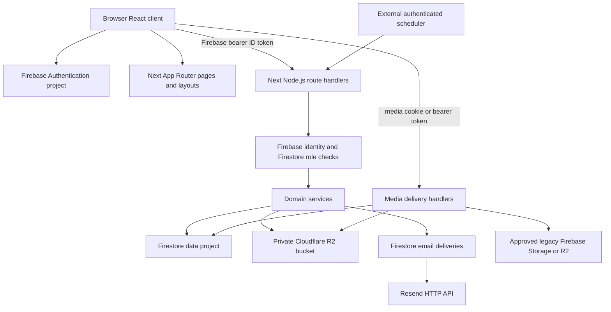
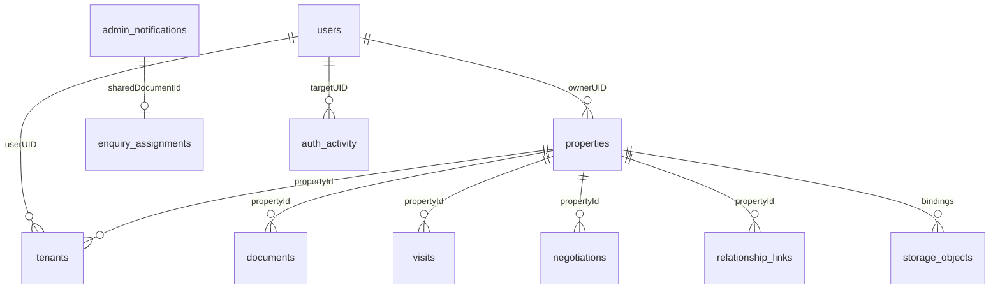

# PropBank ? Master AI Context

> Current mobile policy: schema-2 legacy reservations supersede earlier all-conflicts-must-be-fixed activation requirements. Unique contacts are reserved; duplicate numbers are ownerless blocked claims; missing/invalid profiles are locked in mobile_number_registry_accounts. Historical users stay unchanged. Three private registry collections make 25 total source collections; no new API. [Current design, tests and controlled runbook](../MOBILE_LEGACY_RESERVATIONS.md).

> Implementation update (2026-11-06): K05 has a tested transaction-backed mobile registry implementation on `fix/mobile-number-uniqueness`, but production reconciliation/backfill/activation is pending. The historical statements below describe the audited starting commit. Current behavior, two new server-only collections (24 total), fail-closed rollout requirements and test limits supersede those mobile-specific statements: [Mobile uniqueness implementation and rollout](../MOBILE_NUMBER_UNIQUENESS.md).

> Source audit: 2026-11-06 (Asia/Calcutta). Branch `main`, commit `fa98b7e0e53d29053365be4c1a1b8230a313f686`. Static inspection only; no production database access, external service health checks, browser tests, migrations, push or deployment. ?Implemented? means a source-complete path with identifiable validation and authorization; it does not certify successful runtime operation. Historical reports are secondary evidence only.

## Reading contract and provenance

This self-contained handoff summarizes the eight detailed files below. Treat source and explicitly verified deployment settings as authoritative over this dated snapshot. Counts: **50 feature entries**, **60 API route files / 89 business method-path operations**, **22 top-level Firestore collections**. Counts exclude unsupported methods/preflight; features include partial/missing capabilities. Static source evidence covers implementation and boundaries, not current live health. No customer records were accessed or copied.

Documentation-only scope: no source/config/security/auth setting modifications, database operations, migrations, live API/provider calls, browser tests/extensive suites, push or deployment. Baseline working tree was clean. Generation date **2026-11-06, Asia/Calcutta**, branch **main**, commit **fa98b7e0e53d29053365be4c1a1b8230a313f686**. Recheck these before future development. Installed Next documentation under node_modules/next/dist/docs must be read before Next changes as local AGENTS.md requires.

## Project identity, purpose, stack and decisions

### Identity and business purpose

PropBank combines a public real estate catalogue with property portfolio and rental operations. Individuals can discover buy/rent listings, submit enquiries and offers, arrange visits, and manage properties and tenancy records. Agents can submit listings for separate registered owners and handle assigned enquiries and negotiations. Administrators moderate listings, verify reported ownership, manage accounts, process requests and oversee visits. This interpretation follows `src/app/layout.tsx`, `src/features/properties/ManageProperty.tsx` and the server services, rather than marketing claims.

### Stack

| Package | Declared version/range | Lockfile version |
| --- | --- | --- |
| next | 16.4.0 | 16.4.0 |
| react | ^19.3.0 | 19.3.0 |
| react-dom | ^19.3.0 | 19.3.0 |
| typescript | ^5.8.3 | 5.9.3 |
| firebase | ^12.4.0 | 12.19.0 |
| firebase-admin | 13.10.0 | 13.10.0 |
| @aws-sdk/client-s3 | ^3.1147.0 | 3.1147.0 |
| @tanstack/react-query | ^5.83.0 | 5.104.1 |
| tailwindcss | ^3.4.17 | 3.4.19 |
| zod | ^3.25.76 | 3.25.76 |
| react-hook-form | ^7.61.1 | 7.89.0 |
| @playwright/test | ^1.63.0 | 1.63.0 |

Next.js App Router runs React/TypeScript UI and Node.js API handlers in one application. Firebase client SDK handles authentication; Firebase Admin handles server identity, Firestore and legacy Storage. Cloudflare R2 uses the AWS S3 SDK. Resend is called over HTTP, not a Resend SDK dependency. Radix UI, Tailwind CSS 3, CSS modules, Lucide, React Hook Form and TanStack Query support the client. Zod is installed; do not assume every server request uses it.

### Roles and relationships

The only persisted roles are `admin`, `agent`, `individual` (`src/lib/server/auth.ts`). ?Owner?, ?tenant?, ?customer? and ?broker? are contextual relationships, not additional account roles. A user can own one property, rent another, and be a prospective buyer elsewhere. `brokerUID` identifies an assigned agent; `agent` alone grants no administrator authority. Self-registration offers individual or agent; administrator promotion requires an existing administrator.

### Main workflows

1. Register through Firebase email/password or Google, complete name/mobile/role profile, verify email, establish PropBank login and private media session.
2. Submit owner listing or tenant intake. Server validates category/structure/terms, creates property, synchronized tenant records, pending relationship claims and selected email outbox records. New listings enter `pending_review`.
3. Administrator approves publication. Public access requires `publicListing` eligibility; editing published listing content triggers another review.
4. A tenant intake stores reported owner information with empty legal `ownerUID`. Verified identity discovery and explicit owner review with document evidence precede owner linkage.
5. Manage tenancy, documents, inspections, service requests, rent schedules, manually recorded rent ledger, renewal and early termination requests.
6. Customer enquiry enters notifications; administrator assigns agent; assigned agent tracks status. Negotiation has a separate versioned state machine with owner and customer acceptance.
7. Visits persist before notification attempts. An authenticated external scheduler must invoke reminders; deployment scheduling is not configured in repository code.

### Current state and decisions

This is a substantial application with 60 API route files and 89 business HTTP method/path operations, not a proof of production readiness. Runtime correctness, provider delivery, live rules/indexes and deployed environment remain unverified. There are numerous unit/source-contract and Playwright tests, plus historical audit artifacts; none were run for this documentation task.

Native handlers preserve older Go JSON semantics through `src/lib/server/services/go-contracts.ts`, `contracts.ts`, `domain-contracts.ts` and `src/lib/server/native-group1.ts` / `native-group2.ts`. The active API base is `/api` (`src/utils/config.ts`); a separate Go runtime is not required by the active route wiring. Legacy comments and compatibility responses still refer to Go/ShoPROP.

Auth and data Firebase apps are intentionally separate, lazy singletons (`src/lib/server/firebase-admin.ts`). Firestore Admin bypasses client security rules: application services are the enforceable authorization layer for these requests. Files now use managed private R2 storage plus Firestore binding metadata; only an eligible cover/banner can be publicly delivered. Transactional writes coordinate selected business mutations with email intents, but other effects remain best effort.

Use [ARCHITECTURE.md](ARCHITECTURE.md), [FEATURE_INVENTORY.md](FEATURE_INVENTORY.md), [DATABASE_SCHEMA.md](DATABASE_SCHEMA.md), [API_REFERENCE.md](API_REFERENCE.md), [AUTH_AND_SECURITY.md](AUTH_AND_SECURITY.md), [KNOWN_ISSUES.md](KNOWN_ISSUES.md), [DEPLOYMENT.md](DEPLOYMENT.md) and the self-contained [PROPBank_AI_CONTEXT.md](PROPBank_AI_CONTEXT.md).

## Application architecture and module dependencies

### Application boundary

### Directory map

- `src/app`: App Router entry points, layouts, API route files, error/not-found and informational pages.
- `src/features`: domain UI: account, auth, admin, properties, services, enquiries, negotiations, visits, public landing/search/navigation/footer.
- `src/ui`: reusable Radix/shadcn style controls. `src/components`: application shell, guards, PWA, media and shared forms.
- `src/contexts`: Firebase auth/profile/media lifecycle and public search state. `src/hooks`: query hooks and view utilities.
- `src/services`: browser API wrappers. `src/lib`: validation, domain policies, state machines, navigation and refresh conventions.
- `src/lib/server/services`: server business logic; `src/lib/server`: identity, Firestore/Admin, HTTP, permissions, R2, file projections and metrics.
- `public`: brand/static assets, manifest, icons, service worker and offline page. `scripts`: audits, fixture management, legacy wiring, live verification. `tests`: unit/contracts and browser suites.
- Root historical reports and audit directories describe prior work; `.history`, browser results, `.cache`, `.next` and `node_modules` are not active source modules. Package/lock/config and tracked files were inventoried; customer-bearing logs and environment values were not copied into this knowledge base.

### Frontend composition and routing

`src/app/layout.tsx` wraps children with Suspense, `src/app/providers.tsx` and `src/components/ApplicationShell.tsx`. Providers supply a QueryClient (60-second stale time, retries disabled by default), AuthContext, SearchContext, tooltips and toasts. The application shell owns site chrome. Pages generally delegate to feature components; business interactions run in client components.

The `(protected)` route group uses its layout and `src/components/RouteGuard.tsx`; it does not create a URL segment. `/admin` has a dedicated guarded layout. The guard is a client UX boundary, not server authorization. No checked-in middleware/proxy route guard was found. API handlers enforce their own identity and object access. Dynamic route context uses awaited Promise params, consistent with the installed Next documentation at `node_modules/next/dist/docs/01-app/03-api-reference/03-file-conventions/route.md`.

### State and invalidation

TanStack Query caches property/user data. Query keys include UID for important protected resources; `src/contexts/AuthContext.tsx` clears the query cache when identity changes. Local component state manages drafts, tabs, dialogs and upload state. `src/contexts/SearchContext.tsx` carries search state. `src/lib/data-refresh.ts` maps successful API mutations to affected domains and broadcasts refresh events; mounted consumers invalidate queries/refetch. This is not a server push or Firestore realtime listener system.

`src/lib/api-client.ts` waits for Firebase auth readiness, gets current ID token per same-origin `/api` call, and prevents a request started under one UID from silently using another. External URL requests do not receive the injected bearer token. `loadAuthProfile` coalesces concurrent checks and retries some 500/503 responses once, but not quota exhaustion.

### Backend and service dependencies

Thin `src/app/api/**/route.ts` modules bind methods to services and `handle` wrappers; unsupported exports return 405. Most are force-dynamic Node handlers. Shared `src/lib/server/http.ts` formats responses, applies file projection and maps access/config/dependency failures. Legacy collection/trailing slash behavior is preserved by native wrappers, including redirects and a compatibility health response on some upload/agreement trailing-slash requests.

`properties.ts` depends on users, listing/category/validation policies, media, relationships, notifications and email. `tenants.ts`, `agreements.ts` and `owner-verification.ts` update property relationships and parallel tenant documents. `property-hub.ts` aggregates lifecycle, rent, files, maintenance, offers and visits. `notifications.ts` is both a public enquiry intake and an authenticated operational inbox; `enquiries.ts` adds private broker tracking in its own collection. `negotiations.ts` is independent from enquiry assignment. `migration-remainder.ts` contains active login, service catalogue/requests, reports/reviews and site settings despite its historical name.

### Data, uploads and email

Firebase Admin data access is server-only, with string collection constants and additional literal collection names. Legacy generated schemas control nested encoding, omitempty behavior, nil arrays and date serialization; native additive fields are handled alongside them. Types are not enforced by Firestore itself. Dates mix Firestore Timestamp, JavaScript Date and ISO/date-only strings. Money mixes strings in rental/property models with numeric negotiated amounts.

`src/lib/server/services/media.ts` writes durable upload intent, uploads at `managed/{id}` to a separate private bucket, then moves metadata through pending/attached states. Transactions bind objects to allowlisted fields and property IDs. Downloads re-read bindings and property permissions; public delivery is restricted to approved available cover images or site banners. `src/lib/server/file-projection.ts` projects legacy references into authenticated proxy URLs. Cleanup has leases/tombstones and an admin reconciliation API. Legacy deletion records approval-required cleanup rather than deleting arbitrary external URLs.

`src/lib/server/services/transactional-email.ts` supports atomic outbox staging and post-response `after()` dispatch. Other callers enqueue after business commits with best-effort catches; delivery is not universally atomic with business data. Provider attempts use leases, deterministic idempotency and a maximum of five attempts; older ambiguous deliveries need reconciliation. Resend acceptance is not inbox delivery. No provider webhook route exists. See API and deployment references for authorized retries and reminder cursors.

### Complete page route map

- `/(protected)/add-property` ? `src/app/(protected)/add-property/page.tsx` (route group omitted from actual URL)
- `/(protected)/add-tenant/[propertyId]` ? `src/app/(protected)/add-tenant/[propertyId]/page.tsx` (route group omitted from actual URL)
- `/(protected)/archived-properties` ? `src/app/(protected)/archived-properties/page.tsx` (route group omitted from actual URL)
- `/(protected)/attach-documents/[propertyId]` ? `src/app/(protected)/attach-documents/[propertyId]/page.tsx` (route group omitted from actual URL)
- `/(protected)/edit-property/[propertyId]` ? `src/app/(protected)/edit-property/[propertyId]/page.tsx` (route group omitted from actual URL)
- `/(protected)/inspection-report/[propertyId]` ? `src/app/(protected)/inspection-report/[propertyId]/page.tsx` (route group omitted from actual URL)
- `/(protected)/legal-services/[propertyId]` ? `src/app/(protected)/legal-services/[propertyId]/page.tsx` (route group omitted from actual URL)
- `/(protected)/manage-property` ? `src/app/(protected)/manage-property/page.tsx` (route group omitted from actual URL)
- `/(protected)/manage-property/[propertyId]` ? `src/app/(protected)/manage-property/[propertyId]/page.tsx` (route group omitted from actual URL)
- `/(protected)/my-account` ? `src/app/(protected)/my-account/page.tsx` (route group omitted from actual URL)
- `/(protected)/other-services/[propertyId]` ? `src/app/(protected)/other-services/[propertyId]/page.tsx` (route group omitted from actual URL)
- `/(protected)/renew-agreement/[propertyId]` ? `src/app/(protected)/renew-agreement/[propertyId]/page.tsx` (route group omitted from actual URL)
- `/(protected)/request-services/[propertyId]` ? `src/app/(protected)/request-services/[propertyId]/page.tsx` (route group omitted from actual URL)
- `/(protected)/review/[propertyId]` ? `src/app/(protected)/review/[propertyId]/page.tsx` (route group omitted from actual URL)
- `/(protected)/select-property-type` ? `src/app/(protected)/select-property-type/page.tsx` (route group omitted from actual URL)
- `/(protected)/tenant-property` ? `src/app/(protected)/tenant-property/page.tsx` (route group omitted from actual URL)
- `/(protected)/terminate-agreement/[propertyId]` ? `src/app/(protected)/terminate-agreement/[propertyId]/page.tsx` (route group omitted from actual URL)
- `/(protected)/visit-planner` ? `src/app/(protected)/visit-planner/page.tsx` (route group omitted from actual URL)
- `/about` ? `src/app/about/page.tsx`
- `/admin` ? `src/app/admin/page.tsx`
- `/auth` ? `src/app/auth/page.tsx`
- `/blog` ? `src/app/blog/page.tsx`
- `/buy` ? `src/app/buy/page.tsx`
- `/contact` ? `src/app/contact/page.tsx`
- `/faq` ? `src/app/faq/page.tsx`
- `/` ? `src/app/page.tsx`
- `/privacy` ? `src/app/privacy/page.tsx`
- `/properties` ? `src/app/properties/page.tsx`
- `/property/[propertyId]` ? `src/app/property/[propertyId]/page.tsx`
- `/rent` ? `src/app/rent/page.tsx`
- `/search` ? `src/app/search/page.tsx`
- `/sell` ? `src/app/sell/page.tsx`
- `/services` ? `src/app/services/page.tsx`
- `/support` ? `src/app/support/page.tsx`
- `/terms` ? `src/app/terms/page.tsx`

## Complete role model, authentication and account lifecycle

### Trust model and account identity

Firebase Authentication UID is the durable account identity. The data project stores `users/{uid}` using that same UID; email/mobile/name are attributes, not primary keys. Auth project and data project are distinct named Admin apps. Browser config must match the Auth Admin project. Roles are read from Firestore profiles, not caller headers or custom role claims.

`src/lib/server/auth.ts` verifies bearer ID tokens with revocation checking. Protected requests also fetch the current Firebase account and profile, reject disabled users, require verified current email, require matching profile email, allowed role, at least two name characters and a normalized Indian mobile. `X-User-ID` is only a checked hint in `identity`, never authentication. Some onboarding handlers deliberately call `verifyFirebaseIdentity` without requiring completed/verified profile.

### Registration, password and Google

`src/features/auth/GoogleAuth.tsx` implements email/password creation, Firebase display name updates, profile POST to `/api/auth/user`, Firebase verification email, verification refresh, login and password reset. It offers `individual` or `agent` account selection. Mandatory mobile uses `src/features/auth/RegistrationMobileField.tsx` and `src/lib/indian-phone.ts`; a valid national number is 10 digits starting 6?9, optionally prefixed +91, stored canonically as +91 plus national digits during creation.

Google uses `signInWithPopup` via `src/firebase.ts`. A new Google identity still needs a completed PropBank profile. For `auth/account-exists-with-different-credential`, the UI retains the pending Google credential, requires password authentication to the existing identity, then calls `linkWithCredential`. Linking does not create a second Firestore UID. Provider enablement, Firebase one-account-per-email behavior, authorized domains and console email policies remain external unknowns.

Firebase handles password hashing, verification links, reset emails and provider login. `/api/auth/login` validates a UID against the bearer identity, synchronizes metadata/activity and discovers links; it returns the existing Firebase ID token, not a separately signed application JWT. Reset activity logging does not prove Firebase sent email or that a password changed.

### Session lifecycle

`src/contexts/AuthContext.tsx` observes ID token changes and exposes only verified, profile-complete users. Profile service failure has a retryable unavailable state instead of treating it as a missing account. Auth profile requests are coalesced. Cache is cleared on UID change; media sessions are cleared/renewed on auth transitions.

Normal APIs use bearer tokens. `/api/media/session` creates a 20-minute Firebase session cookie (`propbank_media`), HttpOnly, SameSite=Strict, Secure in HTTPS/production, Path=/api/media. GET verifies cookie UID against the bearer user; DELETE expires it. It is for file delivery, not general application login. Client renewal runs every ten minutes and on focus/online; secure file failure can be retried. `src/lib/private-file-client.ts`, `src/lib/private-file-session.ts` and `src/components/SessionMediaImage.tsx` coordinate this.

### Permission matrix

| Actor/context | Allowed boundaries | Explicit limits |
| --- | --- | --- |
| Anonymous | Approved eligible public listings, search, static info, active service catalogue, unauthenticated general inquiry | No protected property contacts/documents or role authority |
| Incomplete or unverified Firebase user | Own onboarding profile status and onboarding creation | Cannot use completed-profile services |
| Individual | Own profile; own properties; linked active tenancy; own visits; customer offers; property enquiries | No global inbox/account controls |
| Agent | Same relationship-based personal access; submit for separate registered owner; edit own submitted listing content; assigned enquiries; assigned broker proposals | Agent role grants no general property membership/private files or admin access |
| Owner relationship | Property editing/tenancy operations, member documents/services, rent ledger and owner agreement decisions | Agreement owner endpoints require exact owner UID, even for admin |
| Tenant relationship | Active member services/files/inspections/reviews and tenant agreement requests | No owner approvals, rent ledger edits or arbitrary tenant reassignment |
| Administrator | Global users/properties, moderation, verification, visits, enquiries/assignments, notifications, settings, service request resolution, document review, managed-storage reconciliation, email retry | Cannot use owner-only agreement decisions solely due to admin role; POST user upsert guards self role/status changes; PUT/PATCH user update does not apply the same guard |
| Scheduler | Reminder endpoint using CRON_SECRET bearer secret | Firebase user tokens are not scheduler credentials |

`src/lib/server/permissions.ts` supplies self/admin, owner/admin and property membership checks. Tenant authorization requires an active embedded tenancy: exact `userUID`, or legacy verified-token email match only when no UID and no confirmation requirement. Phone equality never grants tenancy access. Some services support legacy root tenant email fallback; do not generalize this to every endpoint.

### Relationship linking and ownership

`src/lib/server/services/relationship-links.ts` discovers only claims matching the current Firebase Admin verified email, or a phone present in both token and current Firebase Auth record. Email claims never fall back to phone. Ordinary editable profile mobile is deliberately excluded. Claims require eligible current property/tenant data and expire after 30 days unless already terminal. Confirmation actions require recent auth (five minutes), recheck live identity/profile, reject self-claims, and atomically bind the standalone tenant and embedded row. Owner authorization is explicit; tenant confirmation alone may stop at `pending_owner_authorization`.

Tenant-intake ownership claims move to `pending_admin_verification`, not directly to owner. `owner-verification.ts` requires an administrator, current verified owner account, property-linked evidence document and review note; versioned approval writes owner identity and updates tenant owner references. It refuses active tenant-as-owner. Rejection/reconsideration preserve tenancy. No automated legal ownership verification service exists.

### Profile editing and duplicate prevention

`src/lib/server/services/users.ts` checks duplicate `phoneNumber` through an equality query, then creates the UID profile in a transaction that checks only that UID. Two different UIDs can pass the phone precheck concurrently: there is no transactional unique-mobile reservation. Legacy formatting may also defeat exact-string duplicate checks. `updateUser` has a missing-profile creation branch without the duplicate precheck used by `createUser`.

Firebase email duplication rules depend on console settings; Firestore has no independent unique email constraint. Two accounts with different emails but the same person are not deduplicated. Google/password linking is explicit when Firebase signals a provider conflict. Failed profile completion can leave a Firebase user without a complete data profile; completion UI is intended to recover it. A duplicate-phone 409 does not undo Firebase account creation.

`src/lib/server/services/account.ts` allows name, photo, bio, notification preferences and agent agency fields. Email/role/status are not editable through that endpoint. Email changes use Firebase verify-before-update flows, and password changes use Firebase reauthentication. Mobile changes require recent authentication plus matching verified token/current Auth phone; there is no OTP/reCAPTCHA phone enrollment UI or delivery integration, and relationship responses explicitly report `phoneVerificationAvailable:false`. Mandatory registration phone is syntactically validated contact data, not verified ownership.

### Rules, limits and sensitive data

No Firestore rules/index manifest, Storage rules or deployed IAM policy is checked in. Actual client access restrictions, private bucket public exposure, Firebase security settings and service-account privileges cannot be verified here. Admin SDK operations bypass Firestore rules; every newly added endpoint must enforce its own identity and object scope.

Enquiry intake uses transactional replay protection (10-minute window) and per-minute quotas: global 60, contact 5, trusted peer 10 (otherwise shared 60). Only an explicitly configured and trustworthy stripped ingress header (`cf-connecting-ip` or `x-real-ip`) should be used. Relationship reads/lookups, discovery and claims have distributed per-user minute quotas. Invitation mail quotas are sender 10/hour and 30/day, recipient 3/day, enforced transactionally. There is no general API-wide application limiter, and unauthenticated password-reset activity logging has no application limiter in its handler.

Public property projection redacts owner/tenant contact and private fields, supplies only the cover image and omits operational arrays. Media validates property scope and live bindings, rejects arbitrary private external file attachment, and limits bytes/MIME. MIME allowlists do not inspect magic bytes or scan malware. CORS uses wildcard origin without credential allowance in the shared helper; cookie-bound media requires separate same-origin handling. Unexpected server errors are sanitized and logged with references. Logs/history/environment files are sensitive local material; never upload them as project context. See [KNOWN_ISSUES.md](KNOWN_ISSUES.md) for confirmed gaps and conditional risks.

## Feature inventory and practical status

50 capability entries correspond to detailed F01?F50. ?Implemented? means source path present with identifiable validation/authorization; external runtime success remains unverified. ?Partially implemented? includes a material missing integration or known UI/workflow blocker. Do not equate an installed dependency, placeholder label or old report with a working feature.

| ID | Area / capability | Status | Limitation |
| --- | --- | --- | --- |
| F01 | Public website: Public brand and information pages | Implemented | Blog is fixed page content, not a CMS or publishing system. |
| F02 | Public website: Public catalogue and filters | Implemented | Server search filters matching text in memory; no full-text engine or public pagination. |
| F03 | Public website: Public property details | Implemented | Static source path verified; runtime and external dependencies not exercised. |
| F04 | Public website: General enquiry | Implemented | Preferred visit is enquiry data; it does not itself create a visits record. Email best effort. |
| F05 | Registration and login: Email registration and verification | Implemented | Profile failure can leave Auth-only identity; phone uniqueness is not atomic. |
| F06 | Registration and login: Password sign-in and recovery | Implemented | Static source path verified; runtime and external dependencies not exercised. |
| F07 | Registration and login: Google sign-in and provider linking | Implemented | Google/provider configuration and cross-provider email behavior need console verification. |
| F08 | Registration and login: Profile completion gating and retry | Implemented | Client guard is UX only; endpoints separately authorize. |
| F09 | User profile: Self profile and agency details | Implemented | Profile/Firebase updates cross service boundaries; rollback covers only some fields. |
| F10 | User profile: Password/email account changes | Partially implemented | Verified-email profile mismatch is rejected before GET account synchronization; see known issues. Client-reported security event is not server proof of Firebase mutation. |
| F11 | User profile: Mobile contact requirement | Implemented | Syntactic contact validation only, no ownership proof. |
| F12 | User profile: Phone OTP and mobile change enrollment | Not implemented | Backend checks exist but no integrated phone verification UI; API reports unavailable. |
| F13 | Owner dashboard: Portfolio and archive | Implemented | Agent submitted-property projection can be omitted by owned-only client hook; see issues. |
| F14 | Tenant dashboard: Tenant workspace and property intake | Implemented | Reported owner is not legal owner until admin review. |
| F15 | Admin dashboard: Administrator portal | Implemented | Tab-dependent agent loading can leave enquiry assignment options empty on first entry. |
| F16 | Admin dashboard: Account role/status management | Implemented | Cross-project Auth/data writes are not a single transaction. |
| F17 | Property management: Property creation/categories/pricing | Implemented | Content fingerprint deduplicates equivalent submissions without a documented expiration. |
| F18 | Property management: Property editing and archive state | Implemented | No property DELETE endpoint; archive via status flags. |
| F19 | Property management: Agent listing submission | Implemented | Submitting a listing does not grant general private file or property membership rights. |
| F20 | Property listing and moderation: Publication review | Implemented | Legacy records lacking explicit approved moderation are not public. |
| F21 | Tenant relationships: Tenant add/update/remove | Implemented | Deletion is deactivation, not record erasure; historical denormalized fields need consistency. |
| F22 | Tenant relationships: Pending connections and identity discovery | Implemented | 30-day pending expiry; per-state result caps; phone-only claims require externally verified Auth phone. |
| F23 | Tenant relationships: Administrator tenancy assignment | Implemented | Relationship effects must be distinguished from a global tenant role. |
| F24 | Rent management: Rent schedules and escalation | Implemented | Money is frequently string data; schedule dates are not payment confirmation. |
| F25 | Rent management: Rent ledger and receipts | Implemented | 120 entries/500 history cap; no payment gateway or bank reconciliation. |
| F26 | Rent management: Payment collection integration | Not implemented | Manual payment-recorded email is not an electronic payment transaction. |
| F27 | Rental agreements: Renewal requests and decisions | Implemented | 500 history cap; electronic signatures/legal registration are not implemented. |
| F28 | Rental agreements: Termination and notice | Implemented | Notice does not schedule automatic effective-date termination; history retained. |
| F29 | Rental agreements: Next agreement drafts | Implemented | Draft is not a signed/executed agreement. |
| F30 | Property enquiries: Authenticated property enquiry | Implemented | Stored in notifications, not an enquiries collection. |
| F31 | Broker assignment: Enquiry assignment and status history | Implemented | Enquiry inbox has N+1 reads; no cursor pagination. |
| F32 | Property visits: Requester visit planner | Implemented | ADMIN_EMAIL needed on creation; future dates; reminders forced to email/30 minutes; elapsed time does not mark completion. |
| F33 | Property visits: Admin visit operations | Implemented | All-visits scans and related lookups; no cursor pagination. |
| F34 | Negotiations: Offer and broker/owner/customer state machine | Implemented | 100-history cap and bounded queries; combined sell_rent listings fail negotiation creation; agreement/payment settlement is separate. |
| F35 | Owner verification: Evidence-backed ownership review | Implemented | Manual review; UI has verified/approved status inconsistency in directory. |
| F36 | Email notifications: Transactional notifications and outbox | Partially implemented | Provider delivery untested; some effects remain best effort; no automatic general outbox drain or delivery webhook. |
| F37 | Email notifications: Relationship invitation email | Implemented | Invitation email conveys no authorization; sending depends on configured origin/provider. |
| F38 | Email notifications: Delivery monitoring interface | Partially implemented | Component exists but no active import/use in admin portal found; API is implemented. sent means provider acceptance. |
| F39 | Reminder workflows: Visit reminders | Partially implemented | External schedule unknown; query caps 1000 upcoming visits and 20 due visits per invocation. |
| F40 | Reminder workflows: Rent due and agreement expiry reminders | Partially implemented | 250-property pages, 20 event attempts, signed continuation cursor requires external follow-through; no backfill guarantee. |
| F41 | File management: Managed private uploads/downloads | Implemented | 20 MiB object limit; document policy tighter for supporting files; actual bucket privacy/IAM unknown. |
| F42 | File management: Documents and supporting reports | Implemented | Supporting max 5 files, 5 MiB each, 20 MiB total is checked outside final transaction; race risk. |
| F43 | File management: Storage cleanup and legacy bridge | Implemented | Legacy metadata deletion cannot revoke historic public object URL; migration requires separate authorization. |
| F44 | Other modules: Maintenance/legal/related service requests | Implemented | Some legal/other flows use notification records rather than service_requests; no provider fulfilment integration. |
| F45 | Other modules: Inspection reports | Implemented | Submitted report is user-authored, not a certified inspection integration. |
| F46 | Other modules: Relationship reviews | Implemented | No public ratings marketplace/moderation workflow verified. |
| F47 | Other modules: Property hub timeline and operational metrics | Implemented | Global property read before authorization filtering; output capped to 250 after scan. |
| F48 | Other modules: Site settings and banners | Implemented | Some read failures return defaults, masking dependency errors. |
| F49 | Other modules: PWA and offline fallback | Implemented | No offline transactional writes or push notification delivery; API/private responses are not cached by service worker. |
| F50 | Other modules: Demo form autofill | Implemented | Demo inputs do not isolate persistence automatically; never use against production without authorization. |

No online rent charging/settlement, integrated SMS/OTP enrollment, e-signature/legal-registration provider, dynamic blog CMS or push-notification delivery was found. Enquiry stage labels do not create visit/offer records. Agent signup is available but does not grant global broker access. The email delivery monitoring API exists, while the AdminEmailDeliveries component is not wired into the active portal.

## Important workflow details for precise future instructions

### Property intake and publication

CreatePropertyRequest uses propertyTitle/propertyType/location, with ownerUID for normal owner flow. Categories residential/commercial/industrial must match structure/layout/units. Listing types rent/sell/sell_rent/manage. Agent supplies agentOwnerEmail resolving to a separate active verified registered owner, and receives submittedByUID/submittingAgentUID scope. Normal owner requests cannot reassign ownership by editing UID. Tenant intake creates a rental record with active self tenant, reportedOwner contact, empty legal ownerUID and ownershipVerification=pending; it is excluded from public listings.

Canonical request fingerprint/property_submissions receipt deduplicates equivalent submissions; there is no code-enforced receipt expiry. Server stages managed media and claim/email intents; transactions synchronize business records. New listings have moderationStatus=pending_review and revision/history. Explicit admin approval is required to publish. publicListing requires isActive, noninactive, non-tenant origin, allowed public listing type, available/rent eligibility, not sold/isRented and moderation approved. Public projection redacts private contacts/operational arrays and limits images to first cover. Member projections can include full operational property details; do not reuse them as public responses.

Moderation approve/reject/request_changes/resubmit requires matching expectedRevision. Reject/change requests need reason. Admin decides; editor resubmits. Listing-content edits invalidate approval. Archive uses active/status flags and retains records; there is no property DELETE route. Legal ownership verification status verified is distinct from listing moderation approved.

### Relationship confirmation and reported owner verification

Tenant relationship exists both as tenants/{id} and property.tenants row. Normal add creates pending row with userUID empty and linkConfirmationRequired=true; typed phone/email does not itself grant membership. Claims use deterministic hashes, current Firebase verified email or matching token/current Auth phone, version and 30-day pending expiry. Email claims never fall back to phone. Discovery is self scoped; confirmation rechecks live identity/profile/property/tenant. Self-claim and owner=candidate conflicts rejected. Recent auth is required for claim actions. Tenant confirmation can wait at pending_owner_authorization if owner has not authorized; owner authorization plus explicit candidate acceptance leads to linked UID in both records. Terminal linked relationship does not expire just because original pending TTL elapsed.

Tenant-origin owner claims go to pending_admin_verification. Admin verifies an active separate verified Firebase owner account, same-property evidence document and review note, rechecks revision and current claim, then sets ownershipVerification=verified plus ownerUID/contact and synchronizes tenant ownerUIDs. Reject/reconsider retain tenancy. This is manual evidence review, not automated legal certification. Admin tenancy assign/replace/remove requires expectedRevision and current owner linkage; remove/normal tenant delete deactivates instead of erasing history.

### Rent, agreements, documents and services

Rent schedules combine legacy yearly string amounts with validated dated extra periods. Ledger monthly map uses numeric expectedRent and status due/paid; owner/admin manually records payment, linked receipt, notes, actor/time and optimistic version/history. Derived due rows do not prove an invoice/payment transaction. No gateway moves money. Ledger caps 120 entries/500 history and notes cap 200. Calendar dates, lease strings and full timestamps have distinct semantics.

Renewal request saves proposed terms; exact owner approves/completes pending request or rejects; approval cannot silently edit proposed terms and synchronizes lease data in both tenant stores. Tenant request route requires active tenancy. Termination can be tenant request, owner dated notice, owner immediate termination or rejection. Immediate termination deactivates tenant rows, clears current terms and retains snapshots/history. Notice is persisted operational state, not automatically scheduled future termination. Agreement history cap 500. nextAgreementDraft is only future draft data, not a signed contract.

Documents carry property/uploader/type/reference, optional TDS/payment financialYear/period/amount/receiptDate and admin status/comment/history. Supporting rental_agreement/rent_receipt/property_supporting_document types are PDF/JPEG/PNG/WebP, <=5 files, <=5 MiB each, <=20 MiB total; quota check is outside final save transaction. Inspections enforce on_possession/on_handover attachment policy and report text. Review type is derived from actual active owner/tenant relation; not an arbitrary supplied reviewer role. Maintenance catalogue merges stored services and defaults; requests carry pending/in_progress/completed/cancelled/resolved plus admin report/images/archive history. Legal/other service workflows also use notification records, so do not assume every request is in service_requests.

### Enquiries, visits and negotiations

General inquiry may be anonymous; property enquiry requires completed identity and private-property membership when listing unavailable publicly. Intake persists admin_notifications and optional email intent with replay/rate controls. Private broker tracking is enquiry_assignments with document ID equal notification ID. Admin assigns active agent; assigned agent/admin updates status with expectedVersion. Statuses: new/contacted/visit_scheduled/negotiating/closed_won/closed_lost. Agent inbox projection deliberately excludes owner contacts/admin remarks/private files. An assignment does not create full property membership.

Visit create requires future RFC3339 visitDate/title, configured valid ADMIN_EMAIL and approved available property if supplied. Reminder type/time forced email/30 minutes. Record persists before best-effort notification attempts. Requester/admin can update with optional expectedVersion; completed/cancelled cannot be changed. Elapsed date is not evidence of completion. Admin listing enriches requester/property. DELETE removes visit record. Creation failure after a business commit must be distinguished from failed email.

Offer create accepts JSON {propertyId,amount}, positive finite numeric amount <=1e10 with <=2 decimals; own property rejected. Current handler further restricts stored listingType to rent or sell despite public sell_rent support, a source limitation. Negotiation keeps ownerUID/customerUID/brokerUID and original/customer/proposed/counter/approved/final amounts, version/history (cap100). Assigned agent/admin proposes; exact owner accepts/counters; customer explicitly accepts owner-approved amount; admin completes only accepted amount equality. Admin assigns broker; customer withdraw/reject rules vary with state. States offered/proposed/countered/owner_approved/accepted/rejected/withdrawn/completed. Completion changes negotiation, not automatic contract execution, payment settlement or property sold/rented flags. Participant queries cap 100 each; list is not cursor-complete.

## Firestore collections, fields and data access

### Scope and interpretation

**22 code-confirmed top-level Firestore collections**: 13 exported in COLLECTIONS plus 9 additional collections used through literals/constants. No subcollection usage was found in active source. This is a source-derived flexible schema, not a live data export or a deployed validation contract. No records or personal data were read. No collections named owners, brokers, enquiries, rent_payments or agreements are invented: those concepts use the records described below.

`src/lib/server/firestore.ts` maps base names. `src/lib/server/services/go-contracts.ts` is a generated legacy schema; `contracts.ts` maps JSON names to persisted field names and controls omitted values. Request/response models are not automatically collections. New native fields coexist with the generated contract. Missing fields, legacy nil arrays and malformed records are handled differently by each service; `getRecords` often skips records that fail model decoding.

Type convention: string = string (including many money/date-only values); int/float64 = number; bool = boolean; time.Time = persisted Date/Firestore Timestamp, JSON ISO string; interface{} = dynamic value; [] = array (often null for absent legacy arrays); * = nullable nested value. Fields in tables are confirmed schema declarations, not a guarantee that all documents contain them. Store-omit means encoder may omit an empty field. Readers can overlay defaults and native code can merge additional fields.

### Collections and operations

#### C01. `users`

- Identity/relationships/operations: UID shared with Firebase Auth; GET self/admin, global list/admin search, onboarding/create and profile updates.
- Model: `User` (full fields below).
- Evidence: `src/lib/server/services/users.ts`, `src/lib/server/services/account.ts`, `src/lib/server/auth.ts`, `src/lib/server/services/auth-activity.ts`.

#### C02. `properties`

- Identity/relationships/operations: Generated listing ID (four letters/four digits with collision fallback); ownerUID, submittedByUID and tenants[].userUID connect users. Public eligibility query, own/submitted equality queries, member reads, transactional create/update/moderation.
- Model: `Property` (full fields below).
- Evidence: `src/lib/server/services/properties.ts`, `src/lib/server/services/property-hub.ts`, `src/lib/server/services/agreements.ts`, `src/lib/server/services/owner-verification.ts`.

#### C03. `negotiations`

- Identity/relationships/operations: Auto-ID; propertyId and ownerUID/customerUID/brokerUID participants. Create/read scoped list; transaction versioned state changes.
- Model: Native/dynamic fields described below.
- Evidence: `src/lib/server/services/negotiations.ts`.

#### C04. `tenants`

- Identity/relationships/operations: ID mirrored in properties.tenants[].id. propertyId, ownerUID and optional linked userUID; property scoped active reads; transactional add/update/deactivate and synchronized property writes.
- Model: `Tenant` (full fields below).
- Evidence: `src/lib/server/services/tenants.ts`, `src/lib/server/services/agreements.ts`, `src/lib/server/services/relationship-links.ts`.

#### C05. `visits`

- Identity/relationships/operations: Generated reference; userId requester, optional propertyId. Self/admin list/detail, create/update/delete, reminder leases.
- Model: `Visit` (full fields below).
- Evidence: `src/lib/server/services/visits.ts`, `src/lib/server/services/reminders.ts`.

#### C06. `services`

- Identity/relationships/operations: Service catalogue ID; read catalogue, merged with hardcoded active defaults; no CRUD admin endpoint.
- Model: `Service` (full fields below).
- Evidence: `src/lib/server/services/migration-remainder.ts`.

#### C07. `service_requests`

- Identity/relationships/operations: UUID; userUID requester, propertyId optional, serviceId catalogue; member/self/admin queries, admin status/archive resolution with media binding transaction.
- Model: `ServiceRequest` (full fields below).
- Evidence: `src/lib/server/services/migration-remainder.ts`.

#### C08. `documents`

- Identity/relationships/operations: UUID or SHA256 UID/property/idempotency key; propertyId, userId uploader; property/type list, member detail, admin review, staged deletion.
- Model: `Document` (full fields below).
- Evidence: `src/lib/server/services/documents.ts`, `src/lib/server/services/media.ts`.

#### C09. `reviews`

- Identity/relationships/operations: UUID; propertyId, reviewerId, ownerId, tenantId; property membership read, relationship-derived reviewer writes.
- Model: `Review` (full fields below).
- Evidence: `src/lib/server/services/migration-remainder.ts`.

#### C10. `inspection_reports`

- Identity/relationships/operations: UUID; propertyId and userId; property/user filtered createdAt descending reads, member create.
- Model: `InspectionReport` (full fields below).
- Evidence: `src/lib/server/services/migration-remainder.ts`.

#### C11. `admin_notifications`

- Identity/relationships/operations: UUID or deterministic event hash; propertyId, userId, ownerId and optional relatedId. Enquiry/request intake, scoped/global read, admin remark/archive/delete.
- Model: `AdminNotification` (full fields below).
- Evidence: `src/lib/server/services/notifications.ts`, `src/lib/server/services/property-effects.ts`, `src/lib/server/services/enquiry-protection.ts`.

#### C12. `email_deliveries`

- Identity/relationships/operations: SHA256 idempotency key; optional recipientUID/propertyId/recordId/invitationClaimId; transactional outbox, leased provider attempts, paged admin reads/retry.
- Model: Native/dynamic fields described below.
- Evidence: `src/lib/server/services/transactional-email.ts`, `src/lib/server/services/relationship-invitation-email.ts`.

#### C13. `siteSettings`

- Identity/relationships/operations: Singleton main_settings; public reads/defaults and admin updates; banner binding metadata.
- Model: `SiteSettings` (full fields below).
- Evidence: `src/lib/server/services/migration-remainder.ts`, `src/lib/server/services/properties.ts`.

#### C14. `auth_activity`

- Identity/relationships/operations: UUID; actorUID and targetUID reference users/Auth. Record supported events and query by targetUID; trims oldest entries beyond 100 after each event.
- Model: Native/dynamic fields described below.
- Evidence: `src/lib/server/services/auth-activity.ts`, `src/lib/server/services/users.ts`, `src/lib/server/services/account.ts`.

#### C15. `enquiry_assignments`

- Identity/relationships/operations: Document ID equals admin_notifications enquiry ID. brokerUID references agent; transactional status/assignment changes with actor revalidation.
- Model: Native/dynamic fields described below.
- Evidence: `src/lib/server/services/enquiries.ts`.

#### C16. `relationship_links`

- Identity/relationships/operations: Deterministic SHA256 relationship/property/tenant/contact identity. Links propertyId/tenantId/ownerUID/candidateUID; discovery queries, authorized state refresh and transactional confirmations.
- Model: Native/dynamic fields described below.
- Evidence: `src/lib/server/services/relationship-links.ts`, `src/lib/server/services/owner-verification.ts`.

#### C17. `relationship_link_limits`

- Identity/relationships/operations: Hashed UID/action/minute key; count increments and expiresAt set in transaction. No user payload beyond opaque ID.
- Model: Native/dynamic fields described below.
- Evidence: `src/lib/server/services/relationship-links.ts`.

#### C18. `email_invitation_limits`

- Identity/relationships/operations: Hashed actor/recipient/time-window quota key; count, expiresAt updated transactionally with invitation outbox decisions.
- Model: Native/dynamic fields described below.
- Evidence: `src/lib/server/services/relationship-invitation-email.ts`.

#### C19. `enquiry_controls`

- Identity/relationships/operations: Hash-based window/replay records. Counters and replay records committed atomically with notification and optional email events.
- Model: Native/dynamic fields described below.
- Evidence: `src/lib/server/services/enquiry-protection.ts`.

#### C20. `property_submissions`

- Identity/relationships/operations: Canonical request SHA256 fingerprint; maps propertyId, submitterUID, createdAt. Read dedupe before upload and create receipt inside property transaction.
- Model: Native/dynamic fields described below.
- Evidence: `src/lib/server/services/properties.ts`.

#### C21. `storage_objects`

- Identity/relationships/operations: UUID; metadata for exact managed/{id} key, uploadedBy UID and property/field bindings. Leased upload/attach/deletion state; admin reconciliation page.
- Model: Native/dynamic fields described below.
- Evidence: `src/lib/server/services/media.ts`.

#### C22. `legacy_storage_cleanup`

- Identity/relationships/operations: Deleted document ID; records historical fileUrl and approval-required cleanup intent while removing metadata in transaction.
- Model: Native/dynamic fields described below.
- Evidence: `src/lib/server/services/documents.ts`.

### Native additions and dynamic document structures

All following fields are confirmed by literal reads/writes or exported interfaces; object members can be optional and history payloads vary by action. No live backfill completeness is asserted.

| Collection | Confirmed native fields and types |
| --- | --- |
| users | isActive:boolean; emailVerified:boolean; accountStatus:string; providerIds:string[]; createdAt/updatedAt/lastSuccessfulSignInAt: timestamp or legacy string; agencyName/agencyPhone/agencyWebsite/bio:string; notificationPreferences:{productUpdates:boolean,activitySummaries:boolean,security:boolean}; legacy rentedPropertyId/rentedPropertyOwnerId/rentedPropertyOwnerName:string (best-effort metadata, not membership authority) |
| properties | propertyCategory/buildingName/plotArea/areaUnit/carpetAreaUnit/constructedAreaUnit/plotAreaUnit/expectedRent/structure:string; createdAs:'owner' or 'tenant' where supplied; submittedByUID/submittingAgentUID:string for agent workflow; reportedOwner:contact object (name/company/contact/phoneE164); ownershipVerification:'pending','verified','rejected'; ownershipVerificationVersion:number; reviewer UID/reviewedAt/reason; ownershipVerificationAudit:{actorUID,ownerUID,evidenceDocumentId,reviewNote,verifiedAt}; ownershipVerificationHistory:decision[]; moderationStatus:'pending_review','approved','rejected','changes_requested'; moderationRevision:number; moderationSubmittedAt/moderationReviewedAt timestamps; moderationReviewerUID/moderationReason:string; moderationHistory:event[]; tenancyRevision:number; createdByUID/adminCreatedForUID:string; relationshipHistory:event[] |
| properties (operations) | agreementStatus:string; agreementRequest:{id,kind,status,requestedBy,requestedAt,terms/proposedTerms,resolvedAt,resolvedBy,noticePeriod,noticeStartDate,terminationDate}; agreementHistory:event[] with previousTerms/previousTenants; noticeStartDate/anticipatedTerminationDate/terminationDate: string or timestamp depending path; nextAgreementDraft:validated object or null; rentLedger:map keyed YYYY-MM with {month,expectedRent:number,dueDate:string,status:'due' or 'paid',receiptId,notes,actorUID,updatedAt}; rentLedgerVersion:number; rentLedgerHistory:event[]; internalNotes:{id,text,actorUID,at}[]; timezone:string when present; isRented:boolean |
| tenants | phoneE164:string; linkConfirmationRequired:boolean; linkedAt:timestamp; linkedByUID:string; assignedByUID/assignmentSource/removedByUID:string; nextAgreementDraft:object or null; agreementVersion/rentSchedule read dynamically for reminders |
| visits | managementVersion:number; visitAdminHistory:event[]; reminderDelivery:{generation,status,lease,leaseUntil,firstAttemptAt,events:email-event[]}; notifiedAt:timestamp or null |
| negotiations | id/propertyId/propertyTitle/ownerUID/customerUID/brokerUID:string; originalAskingPrice/customerOffer:number; brokerProposedAmount/ownerCounterAmount/ownerApprovedAmount/finalAgreedAmount:number or null; status:'offered','proposed','countered','owner_approved','accepted','rejected','withdrawn','completed'; version:number; history:{action,actorUID,amount:number or null,at:ISO string}[]; createdAt/updatedAt:ISO string |
| documents | contentType:string; size:number bytes; idempotencyKey:string; financialYear/period/amount/receiptDate:string; status:'submitted','verified','rejected'; adminComment:string; statusHistory:{status,comment,actorUID,at}[]; deletionStatus:'pending' |
| service_requests | history:{status,action?,actorUID,comment?,at}[]; isArchived:boolean; completedAt:timestamp; adminNotes/resolutionReport/adminImage:string (also see model) |
| admin_notifications | relatedId:string; resolvedAt:timestamp; archiveHistory:event[]; enquiry source fields and contacts are in generated model. Broker tracking is deliberately separate. |
| enquiry_assignments | notificationId/brokerUID/brokerName/status:string; version:number; history:assignment/status events with actor, notes, timestamp; updatedAt:timestamp (no createdAt write in this service) |
| relationship_links | id/propertyId/relationship/tenantId/contactE164/candidateUID/ownerUID/createdByUID:string; recipientEmailNormalized and identityMethod:'email' optional; status canonical states below; version:number; createdAt/updatedAt/expiresAt timestamps; authorizedByUID/authorizedCandidateUID/confirmedByUID/invitationAuthorizedByUID/reviewerUID/approvedOwnerUID:string; linkedAt/confirmedAt/ownerApprovedAt/reviewedAt/rejectedAt/expiredAt/identityUpgradedAt/emailVerifiedAt/phoneVerifiedAt timestamps; verificationVersion:number |
| relationship_link_limits | count:number; expiresAt:timestamp |
| email_invitation_limits | count:number; expiresAt:timestamp |
| enquiry_controls | Counter variant {count:number,expiresAt:timestamp,ttlAt:timestamp}; replay variant {fingerprint:string,notificationId:string,expiresAt:epoch milliseconds,ttlAt:timestamp} |
| property_submissions | propertyId:string; submitterUID:string; createdAt:timestamp; no code-enforced expiry |
| storage_objects | id/bucket/key/uploadedBy/propertyId/filename/contentType/status:string; size:number; privateOnly:boolean; bindings:{collection,id,propertyId,field}[]; createdAt/updatedAt timestamps; cleanupLease:string; leaseUntil:epoch ms; deleteDocumentId:string; lastError:string |
| legacy_storage_cleanup | documentId/propertyId/fileUrl/requestedBy:string; status:'approval_required'; createdAt:timestamp |
| auth_activity | id/eventType/actorUID/targetUID:string; context:allowlisted providerIds/emailVerified/previousRole/role/previousStatus/status/source; createdAt:timestamp |
| email_deliveries | id/eventType/eventId/recipientRole/recipientEmail/subject/html/text/templateId/idempotencyKey/status:string; recipientUID/propertyId/recordId/invitationClaimId/tenancyId/rentPeriod/agreementVersion/scheduledFor/reminderDueDate/reminderAmount optional strings; templateVersion/retryCount/reminderOffset:number; deliveryLease:string; createdAt/updatedAt/sentAt/lastAttemptAt/firstAttemptAt/nextRetryAt/deliveryLeaseUntil timestamps; errorSummary/failureCategory/providerMessageId/providerErrorCode:string; providerStatus:number |

Relationship canonical states are verification_required, pending_owner_authorization, pending_tenant_acceptance, pending_admin_verification, linked, rejected, expired (`src/lib/relationship-link-state.ts`). Historical awaiting_* states are normalized at read/authorized transition time; no startup migration.

Managed storage states include uploading, pending, attached, cleanup_pending, deleting and deleted. Bindings must match a current allowlisted business-record field; metadata alone does not authorize a download.

### Relationships and consistency

These are logical references, not enforced foreign keys. Tenant records duplicate property-embedded rows. Property writes, tenant synchronization, agreement changes, admin tenancy and link confirmation use transactions to maintain both. Owner verification updates property owner and all matching tenant owner references. UIDs must not be reassigned via ordinary form input. A linked tenancy must match current active state; pending claims cannot grant membership.

Money remains strings in legacy property/tenant schemas; negotiations and ledger expectedRent are numeric. Do not perform lexical comparisons for amounts. Legacy calendar dates and full timestamps have different meanings. Reminder code applies a valid property timezone or Asia/Kolkata fallback; visit presentation uses IST. Retain historical snapshots when changing terms, and never infer payment from a due date or elapsed visit time.

### Queries and index requirements

No checked-in firestore.indexes.json or rules file was found. The following are source query shapes and likely composite-index candidates, not proof of deployed indexes. Firestore's actual requirements depend on index configuration; inspect console/emulator errors in separately authorized work.

| Module | Query pattern and index consideration |
| --- | --- |
| Public properties/search | isActive==true AND moderationStatus==approved; optional listingType/projectCondition. Composite/merged equality indexes may be needed. No cursor/limit. |
| Own/agent property lists | ownerUID==UID; submittedByUID==UID; tenant lookup currently scans all properties. |
| Tenants | propertyId==ID AND isActive==true; propertyId equality for synchronization. |
| Relationship claims | recipientEmailNormalized/contactE164 + status, capped 101; candidateUID/ownerUID + status, capped 100 per state; propertyId + relationship for ownership review. |
| Inspections | propertyId or userId equality + createdAt descending (composite candidates). |
| Documents | propertyId equality plus optional documentType equality; sorts createdAt locally. |
| Negotiations | optional propertyId plus ownerUID/customerUID/brokerUID equality; three participant queries, each limit 100; admin limit 100; sort locally. |
| Visits | userId equality then sort/filter locally; admin optional propertyId equality or all; reminder visitDate range now..+7 days ordered ascending limit 1000. |
| Email history | createdAt descending (or __name__ descending legacy mode), pageSize+1 capped 201; snapshot cursor; filters applied after page retrieval. |
| Hub | all properties before membership filtering; related propertyId IN chunks of 30; optional detail queries by propertyId; administrator enquiry pipeline adds notification reads. |
| Auth activity | targetUID equality; full matching snapshot then sort/trim locally. |
| Property reminders | isActive==true, ordered __name__, 250 per page; signed stateful continuation returned. |

TTL fields are written for enquiry/link/invitation controls, but TTL policies are external unknowns. Expiry logic does not prove that old control documents are physically deleted. No general schema migration or automatic index creation is performed.

### Transactions and excessive-read hotspots

Transactions coordinate property submission receipts, property/media/tenant/link changes, enquiry quota+replay+notification+email intent, tenant link confirmations, owner verification, moderation, agreement actions, ledger versions, assignment versions, delivery leases and cleanup leases. External R2/Resend/Firebase operations cannot share a Firestore ACID transaction; ordering/durable intent matters. Some Firebase identity lookups occur inside transaction callbacks and may repeat on transaction retry.

Full scans occur in tenant property matching, hub property selection, admin properties/user directory/search, and some notification/service/visit lists. Admin user listing makes a Firebase Auth getUser for every Firestore user. Admin dossiers read all properties and target activity; enquiry inbox reads tracking per notification and all matching enquiry deliveries. Relationship list executes separate queries for each canonical and legacy state, then property checks. Media delivery reads metadata plus all current bindings and membership; many images amplify reads. Auth activity cleanup queries all matching events per logged activity. Supporting-file quota computes over all property documents before save. Read metrics instrument only property_list/property_detail/delivery_page and estimate document reads; they are neither a global billing counter nor a limiter.

### User account and mobile storage detail

Firebase Auth UID is document ID and logical identity; `uid` is also stored in legacy User model. Users.email must match current verified Firebase email for protected access. users.phoneNumber is a mandatory contact stored as +91 canonical string on new creation. It is not equivalent to Auth phoneNumber or token phone_number. Tenant.phone, tenant.phoneE164, property.mobileNumber/primaryNo/ultNo/ownerPhone and notification userPhone are separate contextual copies, not global verified identity fields. Auth phone enrollment/OTP UI is absent. Phone linking requires token and current Admin account phone agreement, and verified email; email claims use current verified Firebase email and never editable profile values.

Phone uniqueness uses equality prechecks outside the UID creation transaction, so concurrency and old formatting can permit duplicates. The profile creation transaction prevents two writers creating the same UID document; it does not reserve a phone across different UIDs. There is no Firestore unique-email index. See AUTH_AND_SECURITY for account linking and role policy.

The full 333-field persisted/nested legacy schema dictionary is in DATABASE_SCHEMA; this master includes all collections, native additions, relationships, dynamic fields, access patterns and account/mobile semantics above. Request/response models do not imply extra collections. No active subcollections were found. Never invent owners/agreements/rent_payments/enquiries collections.

## API architecture and complete supported route inventory

### Coverage and shared behavior

60 route files; **89 business HTTP method/path operations**, excluding OPTIONS and explicit unsupported exports. Methods below are statically wired; none were called against live services. Route paths use Next segment notation [id]/[propertyId]/[userId] and [...path]; substitute an encoded ID/path on actual requests. All route source files are listed per operation.

Shared source: `src/lib/server/http.ts`, `src/lib/server/auth.ts`, `src/lib/server/permissions.ts`. Authentication below means a Firebase bearer token plus active, verified-email, completed Firestore profile unless explicitly excepted. Refer to AUTH_AND_SECURITY for contextual roles. Same-origin browser requests use `apiFetch`; server Admin SDK bypasses client rules.

Unless explicitly stated otherwise, success is HTTP 200. Creates often use 201; idempotent replays often use 200. API envelopes vary: bare arrays, data/user/property/record fields, null collections and omitted data fields coexist. Clients must check HTTP status and success semantics. JSON helper adds private,no-store and projects private file references; plain errors can be text/plain. Shared AccessError/ApiError is JSON {success:false,message,code?} with 401/403 or its explicit status; 429 adds Retry-After:60. Unexpected failures produce sanitized 500 plain/JSON depending handler; Firestore quota -> 503 FIRESTORE_RESOURCE_EXHAUSTED; transient dependency codes -> 503 SERVICE_UNAVAILABLE with reference. Domain code also returns direct 400/404/409/413/502/503 responses. Unsupported exported methods return 405; OPTIONS supports CORS preflight.

`native-group1.ts` and `native-group2.ts` preserve legacy trailing-slash redirects/missing-ID responses. In particular bare files and documents/property routes redirect; certain upload/agreement trailing-slash requests return a legacy 200 compatibility response without invoking mutation. Do not interpret that response as a successful business operation.

| Route | Business methods | Important permission/contract note |
| --- | --- | --- |
| `/api/account` | GET, PATCH | Self; guarded profile fields; GET intended email sync is blocked on mismatched profile. |
| `/api/account/security-event` | POST | Recent-auth self security audit; action and operationId. |
| `/api/admin/email-deliveries` | GET | Admin; see detailed input/version/cursor contract. |
| `/api/admin/email-deliveries/[id]/retry` | POST | Admin; see detailed input/version/cursor contract. |
| `/api/admin/notifications` | GET, POST | Global GET admin/property GET member; POST anonymous general inquiry or authenticated request/enquiry. |
| `/api/admin/notifications/[id]/read` | PUT | Admin; see detailed input/version/cursor contract. |
| `/api/admin/notifications/[id]/remarks` | PUT | Admin; see detailed input/version/cursor contract. |
| `/api/admin/notifications/[id]` | DELETE | Admin; see detailed input/version/cursor contract. |
| `/api/admin/properties/[id]/tenancy` | POST | Admin; see detailed input/version/cursor contract. |
| `/api/admin/site-settings` | GET, PUT, PATCH | GET public, mutations admin. |
| `/api/admin/storage-reconciliation` | GET, POST | Admin; see detailed input/version/cursor contract. |
| `/api/admin/users/search` | GET | Admin; see detailed input/version/cursor contract. |
| `/api/admin/visits` | GET | Admin; see detailed input/version/cursor contract. |
| `/api/agreements/renew` | POST | Exact owner decision; admin alone cannot override; pending requestId for resolution. |
| `/api/agreements/request-renewal` | POST | Active tenant request only; propertyId and proposed terms/notice. |
| `/api/agreements/request-termination` | POST | Active tenant request only; propertyId and proposed terms/notice. |
| `/api/agreements/terminate` | POST | Exact owner decision; admin alone cannot override; pending requestId for resolution. |
| `/api/auth/activity` | POST | Reset-request activity branch public; session/link branches completed user. |
| `/api/auth/login` | POST | Own completed verified profile; returns input Firebase token. |
| `/api/auth/user` | GET, POST | Own Firebase bearer onboarding; profile status/create, no general lookup. |
| `/api/cron/reminders` | GET, POST | CRON_SECRET, not Firebase user; query propertyCursor for continuation. |
| `/api/documents/property` | GET | Member reads/create, admin review, member uploader/owner/admin deletion; property path without ID is compatibility error. |
| `/api/documents/property/[propertyId]` | GET | Member reads/create, admin review, member uploader/owner/admin deletion; property path without ID is compatibility error. |
| `/api/documents` | GET, POST | Member reads/create, admin review, member uploader/owner/admin deletion; property path without ID is compatibility error. |
| `/api/documents/[id]` | GET, PATCH, DELETE | Member reads/create, admin review, member uploader/owner/admin deletion; property path without ID is compatibility error. |
| `/api/enquiries` | GET | Admin/all or agent assigned only. |
| `/api/enquiries/[id]` | PATCH | Admin assign; assigned agent/admin status; expectedVersion. |
| `/api/files` | DELETE | Uploader/admin cleanup; only managed ID, no arbitrary key deletion; bare path redirects. |
| `/api/files/[...path]` | DELETE | Uploader/admin cleanup; only managed ID, no arbitrary key deletion; bare path redirects. |
| `/api/inspection-reports/property/[propertyId]` | GET | Member/property or self/admin user scope; attachment policy. |
| `/api/inspection-reports` | POST | Member/property or self/admin user scope; attachment policy. |
| `/api/inspection-reports/user/[userId]` | GET | Member/property or self/admin user scope; attachment policy. |
| `/api/media/legacy` | GET | Allowlisted record/field and trusted object scope; authenticated. |
| `/api/media/session` | POST, DELETE, GET | POST/GET bearer completed user; GET also cookie; DELETE clears without auth. |
| `/api/media/[id]` | GET | Eligible public cover/banner else live membership via cookie/bearer. |
| `/api/negotiations` | GET, POST | Participant/admin list; completed customer offer amount. |
| `/api/negotiations/[id]` | PATCH | Participant/admin and exact role/action rules; version required. |
| `/api/owner-verification` | POST | Admin with verified separate owner and property document evidence. |
| `/api/properties` | GET, POST | GET public, ownerUID self/admin, admin=true admin; POST validated owner/agent/tenant intake. |
| `/api/properties/search` | GET | Public approved listings; in-memory text search. |
| `/api/properties/tenant` | GET | Recent-auth self security audit; action and operationId. |
| `/api/properties/[id]` | GET, PUT, PATCH | Public eligible detail or member/agent projection; owner/admin/editor mutations and moderation. |
| `/api/property-hub` | GET, PATCH | Member/admin read; ledger owner/admin, internal note admin. |
| `/api/relationship-links` | GET, POST | Self discovery/current identity or owner claims; recent-auth actions; optional version. |
| `/api/reviews` | GET, POST | Member list; actual owner/tenant author role. |
| `/api/service-requests` | GET, POST | Self/member request/read, admin status/resolution/archive mutation. |
| `/api/service-requests/[id]` | PUT | Self/member request/read, admin status/resolution/archive mutation. |
| `/api/services` | GET | Public active catalogue merged with defaults. |
| `/api/tenants` | GET, POST | Owner/admin mutations; member/own active tenant reads; embedded/standalone sync. |
| `/api/tenants/[id]` | GET, PUT, DELETE | Owner/admin mutations; member/own active tenant reads; embedded/standalone sync. |
| `/api/upload/document` | POST | Authenticated scoped upload; multipart or base64 based on route, managed media intent. |
| `/api/upload/image` | POST | Authenticated scoped upload; multipart or base64 based on route, managed media intent. |
| `/api/upload/property-images` | POST | Authenticated scoped upload; multipart or base64 based on route, managed media intent. |
| `/api/upload` | POST | Authenticated scoped upload; multipart or base64 based on route, managed media intent. |
| `/api/upload/service-request-image` | POST | Authenticated scoped upload; multipart or base64 based on route, managed media intent. |
| `/api/users` | GET, POST | GET admin, POST self/admin upsert. |
| `/api/users/search` | GET | Nonadmin no contact disclosure; admin lookup; throttled. |
| `/api/users/[id]` | GET, PUT, PATCH | GET identity subset/self/admin dossier; self/admin updates with endpoint-specific role/status guards. |
| `/api/visits` | GET, POST | Self/admin; future-date creation; optional management version on update. |
| `/api/visits/[id]` | GET, PUT, DELETE | Self/admin; future-date creation; optional management version on update. |

Each path maps to src/app + path + /route.ts. All 89 method-specific request parameters, response structures, direct errors, auth/data operations and handler references are in API_REFERENCE, including legacy Create*/Update* request model dictionary. This master maps every route without reproducing large field-by-field API repetition. Common action inputs: moderationAction/reason/expectedRevision, negotiation action/version/amount/brokerUID, enquiry action/expectedVersion/status/brokerUID/notes, link action/claimId/expectedVersion, hub action/propertyId/version/month/expectedRent/dueDate/status/receiptId/notes. Not all GETs are logically read-only: link reads increment quota/refresh state and account GET includes attempted synchronization.

### Validation and compatibility limitations

- No universal request schema/error envelope. `readObject` intentionally consumes the first JSON value and permits trailing material to preserve legacy Go behavior. Some handlers have no strict unknown-field allowlist. Never assume a UI validator protects direct API calls.
- Property update retains legacy dynamic fields after protecting identity/history/path-like names; tenant update similarly accepts mutable fields beyond a central strict allowlist. Schema dictionary documents declared fields, not a global Firestore field restriction.
- POST notification includes public general inquiry and authenticated private request paths; `/api/enquiries` is the separate admin/agent inbox, not the enquiry-creation endpoint.
- GET account contains attempted email synchronization/activity reads; relationship GET can persist authorized expiry/canonical-state refresh and increments limiter counters. Reads are not universally side-effect free in application semantics. This audit did not call them.
- Bare `/api/documents/property` and `/api/files` are compatibility/missing-ID entry points. Use explicit property-ID document path and managed file URL as appropriate.
- No payment, SMS, email delivery webhook, e-signature or dedicated role-owner/role-tenant API exists in the route tree.
- See KNOWN_ISSUES for mobile uniqueness races, email synchronization ordering, permissive legacy fields, optional concurrency tokens and deployment request-size risks. Source presence is not provider health or successful end-to-end evidence.

## External integrations, upload and email infrastructure

Firebase client Auth handles passwords/Google/verification/reset links; separate server Auth and data apps use project-scoped service account JSON/path or ADC. Browser config and Auth Admin must match. Data project is intentionally distinct. Firestore and legacy Firebase Storage use DATA app, never borrowed Auth credentials. Configure project IDs explicitly rather than relying on source fallbacks.

Managed R2 upload writes durable storage_objects intent, puts exact managed/UUID key in separate private bucket, then pending. Transactions enforce uploader/property/field bindings and attached state. A listingCandidate flag does not itself publish: delivery checks every live reference, privateOnly veto and eligible cover/banner rule. Private files require current relationship even with valid media cookie. Unattached files are uploader/admin scoped plus property scope when present. Arbitrary private external URL attachment is refused; same preexisting legacy reference may be retained.

Cleanup checks binding/current record state, leases/tombstones and exact key, with grace period/retryable cleanup state. Admin dry-run/reconciliation pages 100, explicit POST <=20 IDs. Legacy proxy checks approved R2/GCS host and key scopes; deleting metadata queues approval_required cleanup and cannot revoke a previously known public provider URL. MIME checks are declarations, not magic-byte/antivirus scans. Actual bucket ACLs and host upload/memory limits remain unverified.

Resend is HTTP API (30-second timeout), not a dependency SDK. Selected business transactions stage deterministic email outbox, dispatched post-response via Next after(). Other effects enqueue after business commit with best-effort catches, so notification persistence is not universally atomic. Send leases are two minutes; attempts capped five; delayed retries and roughly 23-hour ambiguity safeguards require reconciliation. Admin retries cannot edit message/recipient and reject obsolete invitation/reminder context. Delivery history masks email and omits html/text. No provider webhook/general outbox drain route found. sent means provider API acceptance, not confirmed inbox delivery. Firebase verification/reset email is independent.

## Security gaps, confirmed bugs and conditional risks

23 documented findings follow. KNOWN_ISSUES contains line references, affected workflows and suggested solutions. No fix was implemented. Conditional hosting/configuration risks are not claims of actual exposure or provider failure.

- **K01 (High) Verified email synchronization blocked by profile gate:** After Firebase completes a verified email change, the stored profile email differs. requireUser rejects completedProfile before readMyAccount can execute its intended verified-email synchronization. The onboarding POST may offer a recovery path, but the normal account GET synchronization cannot run in that state. Verification: Confirmed by static source inspection; not reproduced against a live service.
- **K02 (Medium) Owner verification label uses wrong terminal state:** AdminPropertiesTab checks ownershipVerification != approved; server writes verified. Tenant-origin properties remain presented as reported-owner records even after successful verification. Verification: Confirmed by static source inspection; not reproduced against a live service.
- **K03 (Medium) Agent selector query disabled in enquiry tab:** AdminPortal enables useAllUsers only when activeTab is agents, but passes its result to EnquiryInbox in the enquiries tab. First access to enquiries without visiting agents can have no assignment candidates. Verification: Confirmed by static source inspection; not reproduced against a live service.
- **K04 (Medium) Email delivery UI not wired to active portal:** AdminEmailDeliveries is defined but no active import/render elsewhere in src was found; enquiry error text directs admins to Email deliveries nevertheless. Verification: Confirmed by static source inspection; not reproduced against a live service.
- **K05 (High) Mobile duplicate prevention is not atomic:** checkPhone queries phoneNumber before a create transaction that only reads users/{uid}. Different UID registrations can pass precheck together. updateUser missing-profile branch also saves without duplicate check. Verification: Confirmed missing atomic invariant by static inspection; concurrency outcome not exercised.
- **K06 (Medium) Agent submissions dropped by owned-property hook:** Server ownerUID query merges submitted agent listings with userRole agent; useUserProperties only retains ownerUID=self in owned and userRole tenant in tenant. Separate-owner agent submissions can be dropped from that hook result. Verification: Confirmed filtering behavior; impact on every screen requires UI verification because some screens fetch separately.
- **K07 (Medium) Email retry/outbox recovery depends on explicit invocation:** Outbox can remain pending if after registration/execution fails; no general scheduled outbox drain route was found. Retry API exists, but UI is not wired and some effects are caught after the business mutation. Verification: Confirmed recovery architecture gap; actual stranded deliveries unverified.
- **K08 (Medium) Supporting file count/size quota checked outside save transaction:** createDocument reads all property documents and computes 5-file/20-MiB budget, then separately calls saveMediaRecord. Concurrent requests can both pass. Verification: Confirmed missing atomic quota invariant; race not exercised.
- **K09 (Medium) Full scans and per-item reads remain:** Tenant discovery and hub scan properties; user search/dossiers scan users/properties; admin inbox fetches tracking per notification. Client caching reduces repeated requests but does not bound document reads. Verification: Confirmed by static source inspection; not reproduced against a live service.
- **K10 (Low) Auth activity logging scans matching history for every event:** recordAuthActivity queries all targetUID events then deletes entries beyond 100. Read cost occurs before retention trim. Verification: Confirmed by static source inspection; not reproduced against a live service.
- **K11 (Medium) Public reset-activity endpoint can amplify operations:** password_reset_requested accepts unauthenticated email, looks up Firebase account and writes/trims history without application rate limiting. Generic response limits disclosure but not request cost/audit noise. Verification: Confirmed absent local limiter; external edge/Firebase protections unknown.
- **K12 (Low) Security event records are client assertions:** Recent-authenticated self caller can POST password_changed/email_change_requested without server proof the Firebase operation occurred. UI invokes it after the operation, but direct clients can forge their own audit narrative. Verification: Confirmed trust boundary; does not grant another user access.
- **K13 (Low) Legacy JSON parser accepts trailing content:** readObject stops at first complete JSON value, explicitly preserving Go behavior; modern strict endpoints built on it may surprise clients/security tooling. Verification: Confirmed by static source inspection; not reproduced against a live service.
- **K14 (Medium) Admin Auth/data state updates can partially commit:** updateUser changes Firebase disabled state before persisting Firestore profile; a later failure can leave state out of sync. Account profile rollback after Firebase display-name/photo failure restores only name/photo/time; other Firestore updates remain. Verification: Confirmed operation ordering; failure scenario not induced.
- **K15 (Low) Optional concurrency tokens permit last-write-wins callers:** Visit expectedVersion and relationship expectedVersion are optional. Some legacy updates have optional timestamp guards. Transactions prevent torn writes but do not require callers to acknowledge intervening changes. Verification: Confirmed optional checks; harmful concurrent outcome needs verification.
- **K16 (Medium) Historical public URLs cannot be revoked by projection:** Private legacy references are wrapped in authenticated proxy URLs, but anyone retaining original public URL may still use provider access. Legacy deletion creates approval_required cleanup intent rather than removing the external object. Verification: Conditional risk; original object ACL/public access unverified.
- **K17 (Medium) Deployed database rules/IAM/indexes absent from repository:** No Firestore/Storage rules, index manifest or deployment integration workflow found. Admin SDK bypasses rules. Repository alone cannot establish that direct client data access is blocked. Verification: Unknown external configuration, not a proven exposed database.
- **K18 (Medium) Hosting request/runtime constraints may reject supported app uploads:** App allows 20-MiB files/21-MiB multipart and buffers data on upload/download; actual Vercel/other platform limits and memory/runtime settings were not available. Cron requests may do sequential provider calls. Verification: Conditional deployment risk; no current platform limits were asserted or tested.
- **K19 (Medium) Cron continuation and narrow reminder windows require scheduler design:** Property worker returns nextCursor at 20 event attempts or 250 properties; visit worker caps 1000 upcoming and 20 due visits. No checked-in scheduler follows cursors. Late execution after visit time skips visit reminder. Verification: Confirmed bounded behavior; actual schedule/backlog unknown.
- **K20 (Low) Dependency and type-maintenance risks:** npm legacy-peer-deps is enabled; React 19 and legacy UI library ranges need compatibility review. Generated Go contracts can drift from native additions; several domain components/services retain any/dynamic records. No current vulnerability audit was performed. Verification: Potential maintenance risk; no CVE or incompatible package claimed.
- **K21 (Medium) Tracked production environment file requires controlled review:** git ls-files confirms .env.production is tracked while .gitignore mainly covers local variants. Its values were not copied or treated as safe. Presence alone does not establish credential exposure. Verification: Tracked-file presence confirmed; secret exposure not asserted.
- **K22 (Medium) Self administrator mutation guard differs by endpoint:** POST upsert protects admin self role/status, PUT/PATCH update lacks same guard. Verification: Confirmed source discrepancy; no runtime mutation.

- **K23 (Medium) Combined sale/rent offers:** public listings allow sell_rent while createNegotiation requires stored rent/sell, so combined listings cannot receive offers through that handler. Static mismatch confirmed; no runtime offer submitted. See `src/lib/server/services/negotiations.ts:95` and `src/lib/listing-policy.ts:8`.

## Development, deployment, scheduling and external unknowns

### Local setup (instructions only, not executed during audit)

Use the lockfile with npm and a compatible Node runtime: installed Next package declares Node >=20.9.0. Repository package.json does not pin an engines field or a production runtime version. `.npmrc` sets legacy-peer-deps=true, so installations intentionally bypass peer-dependency enforcement.

1. Install dependencies with `npm ci` in the repository.
2. Populate an ignored local environment from `.env.example`, using approved development/emulator accounts. Do not copy production credentials into shared context.
3. For normal development, `npm run dev` listens on port 8080. It can use whatever backend environment is configured; it is not automatically production-isolated.
4. For isolation, start Firebase Auth/Firestore emulators with an installed Firebase CLI and a demo-/test- project, e.g. `firebase emulators:start --config firebase.emulators.json --project demo-propbank`. CLI/Java prerequisites are not bundled by package.json. Configure the ignored `.env.test-accounts.local` with matching NEXT_PUBLIC_FIREBASE_PROJECT_ID, FIREBASE_AUTH_PROJECT_ID, FIREBASE_DATA_PROJECT_ID and FIREBASE_TEST_PROJECT_ID; local emulator hosts must be loopback host:port. Then `npm run dev:emulator` uses the guarded launcher. Obtain fixture values privately; none are documented here.
5. `npm run build` -> next build; `npm start` -> next start --port 8080. No build/start was run for this audit. Build-time NEXT_PUBLIC variables are compiled into browser assets and must be set in each intended environment before building.

`firebase.emulators.json`: Auth 127.0.0.1:9099, Firestore 127.0.0.1:8081, UI 127.0.0.1:4001, singleProjectMode=true. `scripts/start-emulator-dev.cjs` requires local emulator hosts and matching test project, strips live Firebase credential envs, ADC path, Resend and obsolete Twilio envs before launching Next. It does not replace every external service configuration, so R2 behavior still requires conscious isolation. Fixture seed/cleanup scripts are mutating and were not run.

### Environment variable names

No values, account IDs, bucket names, keys, user identities or tokens are included. Requiredness is conditional on the subsystem being used; optional aliases and externally consumed SDK variables are distinguished in each row.

| Subsystem | Names | Meaning/requiredness |
| --- | --- | --- |
| Browser Firebase (build-time public configuration) | `NEXT_PUBLIC_FIREBASE_API_KEY`, `NEXT_PUBLIC_FIREBASE_AUTH_DOMAIN`, `NEXT_PUBLIC_FIREBASE_PROJECT_ID`, `NEXT_PUBLIC_FIREBASE_STORAGE_BUCKET`, `NEXT_PUBLIC_FIREBASE_MESSAGING_SENDER_ID`, `NEXT_PUBLIC_FIREBASE_APP_ID` | Browser Auth initialization. These are public project configuration identifiers; never put Admin credentials in NEXT_PUBLIC variables. |
| Server Firebase Auth | `FIREBASE_AUTH_PROJECT_ID`, `FIREBASE_AUTH_CREDENTIALS` | Auth Admin project and service-account JSON or path. If credentials absent, uses application default credentials (ADC). Must match browser project. |
| Server Firestore/data and legacy storage | `FIREBASE_DATA_PROJECT_ID`, `FIREBASE_DATA_CREDENTIALS`, `FIREBASE_CREDENTIALS`, `FIREBASE_PROJECT_ID`, `FIREBASE_DATA_STORAGE_BUCKET`, `STORAGE_BUCKET`, `FIREBASE_STORAGE_BUCKET` | Explicit DATA variables preferred. Legacy aliases preserved. Data credentials never borrowed by Auth. Bucket required only for legacy Firebase Storage operations. |
| Cloudflare R2 | `CLOUDFLARE_ACCOUNT_ID`, `CLOUDFLARE_R2_ACCESS_KEY_ID`, `CLOUDFLARE_R2_SECRET_ACCESS_KEY`, `CLOUDFLARE_R2_BUCKET_NAME`, `CLOUDFLARE_R2_PUBLIC_URL`, `CLOUDFLARE_R2_PRIVATE_BUCKET_NAME` | Account/access/secret/legacy bucket required by R2 helper. Public URL optional fallback. Private bucket is additionally required for managed uploads and must differ from legacy bucket. |
| Email and links | `RESEND_API_KEY`, `FROM_EMAIL`, `ADMIN_EMAIL`, `APP_URL`, `NEXT_PUBLIC_APP_URL`, `SUPPORT_EMAIL` | Resend HTTP API key, verified sender and configured admin recipient. APP_URL preferred over NEXT_PUBLIC_APP_URL for absolute action links; invitation templates validate public origin. SUPPORT_EMAIL falls back to sender. FROM_EMAIL has a source default but reminders explicitly require it configured. |
| Scheduler, ingress and diagnostics | `CRON_SECRET`, `ENQUIRY_TRUSTED_IP_HEADER`, `PROPBANK_READ_METRICS` | Cron secret minimum 32 characters; ingress header optional and only safe behind trusted header stripping; read metric flag 1 enables estimates. |
| Local/test/runtime controls | `NEXT_PUBLIC_FIREBASE_AUTH_EMULATOR_URL`, `FIREBASE_AUTH_EMULATOR_HOST`, `FIRESTORE_EMULATOR_HOST`, `FIREBASE_TEST_PROJECT_ID`, `GOOGLE_APPLICATION_CREDENTIALS`, `PROPBANK_TEST_DIST_DIR`, `PROPBANK_DEV_PORT`, `PROPBANK_DEV_WEBPACK`, `NODE_ENV` | Emulator SDK/launcher controls and ADC/runtime settings. Runtime-provided NODE_ENV is not an application secret. Launcher uses isolated test project and strips live credentials/email settings. |

Additional test/live verification scripts consume private fixture selectors and account credentials. They are tooling inputs, not application runtime requirements; discover names directly from the selected script before an explicitly authorized test. The launcher explicitly removes PROPBANK_TEST_USER_EMAIL/PROPBANK_TEST_USER_PASSWORD/PROPBANK_TEST_ADMIN_EMAIL/PROPBANK_TEST_ADMIN_PASSWORD from its child environment. No fixture values belong in shared docs.

### Firebase provisioning boundaries

`src/lib/server/firebase-admin.ts` initializes named propbank-auth and propbank-data apps lazily. Auth project prefers FIREBASE_AUTH_PROJECT_ID then browser project then a source fallback. Data project prefers FIREBASE_DATA_PROJECT_ID then FIREBASE_PROJECT_ID then a different source fallback. Configure explicitly to avoid unintended fallback selection. Credential parser accepts inline JSON or readable file path and rejects a service-account project mismatch. For credential-free ADC, the host needs properly scoped identity for each operation/project. Production IAM, enabled providers, domains, quotas, rules and indexes are unknown from repository inspection.

No Firestore/Storage rule or index manifest is checked in. Do not deploy permissive guessed rules or run data backfills based on this documentation. Obtain authorized deployed configuration and reconcile code query shapes in DATABASE_SCHEMA before changing policies.

### Storage and email provisioning

Managed files require a separate private R2 bucket, server credentials permitting exact-object put/get/delete, and authenticated media routing. Legacy bucket/public URL settings remain to resolve historical references. Do not make the private bucket publicly accessible. Actual R2 bucket ACLs, custom domain behavior, CORS and key scopes were not inspected. Server buffers media; host request/memory/time limits must be verified separately.

Resend uses server fetch to its emails API, 30-second abort timeout, optional Idempotency-Key and branded HTML/text. Configure approved FROM_EMAIL sender/domain DNS and ADMIN_EMAIL. APP_URL should be the canonical application HTTPS origin so invitations and notifications link to the correct environment. No DNS/provider dashboard delivery health was checked. Firebase verification/password reset messages are separate from the Resend business email infrastructure. Twilio variables stripped by the test launcher do not establish an implemented SMS integration.

### Hosting, branch and CI/CD

The repository can run as a Node.js Next deployment. Vercel is a plausible hosting target, but no vercel.json, checked-in .vercel project linkage or .github workflow was found in the active repository inventory. Actual host/project, GitHub App integration, linked repository, production domain, production branch, deployment IDs and preview/prod environment values are **unknown**. An installed connector is not evidence of a specific deployment. No external dashboards were accessed.

The audited local branch is `main`, commit `fa98b7e0e53d29053365be4c1a1b8230a313f686`. Do not infer that main is the configured production branch. Current commit subject was ?Restore PropBank stable version 04-11-2026?; that is historical commit metadata, not runtime health evidence.

`next.config.ts` sets LAN allowedDevOrigins, Turbopack root, optional PROPBANK_TEST_DIST_DIR and skipTrailingSlashRedirect=true for compatibility. There are no active external backend rewrites in this file. Read native wrapper behavior before changing slash redirects; some compatibility endpoints would otherwise loop or change contract.

### Scheduled work and recovery

An external scheduler must invoke GET or POST `/api/cron/reminders` with `Authorization: Bearer <CRON_SECRET>`. Calls write reminder state/send email; do not invoke during a read-only audit. Visit reminders query now to seven days ahead (cap 1000), select at most 20 due visits, use four concurrent workers and requester/admin delivery events with leases. A visit reminder is due only before the visit; late scheduling can miss it.

Property reminders scan active properties in 250-document ID pages and attempt at most 20 events per call, returning properties.nextCursor. The scheduler must continue with query propertyCursor until exhausted and observe limited/failed/needsReconciliation. Rent offsets are 7/1/0 calendar days; agreement expiry offsets 30/15/7; already-paid months and inactive/ended rentals are excluded. Timezone fallback is Asia/Kolkata. No documented cron frequency/deployed schedule exists in repo. Design frequency around visit windows and daily calendar reminders, host duration budgets and continuation retries.

There is no general automatic email outbox sweeper route. Pending/failed records can be retried through admin API, with still-current context checks and attempt/time safeguards. Storage reconciliation GET is a dry run; POST deletes only specifically selected eligible managed objects, uses a 24-hour grace rule unless cleanup state bypass applies, and must be separately authorized operational work. TTL fields on control docs require external Firestore TTL policies; actual policies are unknown.

Tests: many .test.cjs files transpile source with mocked dependencies or assert source contracts; .spec.ts are Playwright browser suites. package.json exposes lint/typecheck/test:server/test:functional/test:auth/test:storage plus routing/audit helpers. Existing test presence or old reports do not establish current integration health. No test suite was run in this documentation-only task. scripts named live/reset/fixtures/wire can mutate providers/data/source; inspect target and emulator safeguards before any separately authorized run. Full inventory is in DEPLOYMENT.

Preserve native API compatibility, exact role vocabulary, separate Auth/data projects, tenant row consistency, private media binding checks, publication/ownership state separation and history/version guards. Avoid global scans/N+1 expansion and never infer paid/completed from date passage. Runtime unknowns: actual host/project/Node/build status, configured production branch (local main does not prove it), GitHub integration, deployed domains/envs, Auth providers/domains/one-account-per-email policy, database rules/indexes/TTL/IAM, R2 public/private/legacy ACLs, Resend DNS/sender/inbox health, cron frequency/cursor drain/backlog, host body/runtime limits, backups/monitoring/retention. No live dashboard/config inspection was performed.

## Detailed documentation links

- [PROJECT_OVERVIEW.md](PROJECT_OVERVIEW.md): identity, stack and workflows.
- [ARCHITECTURE.md](ARCHITECTURE.md): modules/diagrams/page routes.
- [FEATURE_INVENTORY.md](FEATURE_INVENTORY.md): 50 entries with API/data/source/permissions/status.
- [DATABASE_SCHEMA.md](DATABASE_SCHEMA.md): 22 collections, full legacy field dictionary, native additions, queries/transactions/read costs/mobile.
- [API_REFERENCE.md](API_REFERENCE.md): all 89 operations, parameters/responses/errors/auth/database/source evidence.
- [AUTH_AND_SECURITY.md](AUTH_AND_SECURITY.md): account/provider/session/relationship trust model.
- [KNOWN_ISSUES.md](KNOWN_ISSUES.md): 23 severity/evidence/verification findings.
- [DEPLOYMENT.md](DEPLOYMENT.md): environment names, local setup, scripts/tests/scheduler and dashboard unknowns.

## Documentation consistency validation

Static validation on 2026-11-06 checked 293 existing source references (including cited line bounds), internal documentation links, all 89 documented method/path operations against 60 route files, all 22 collection names against active source literals/constants, 50 numbered feature entries and 23 numbered findings. No missing source paths, broken documentation links, missing/extra API operations or unsupported collection names were found. Exact runtime role union was checked as admin/agent/individual. Secret-pattern checks and comparisons against private environment assignment values found no matches in the documentation. This check does not certify external configuration or service health. No customer records, browser tests or live APIs were accessed. Tracked application/configuration diff remained empty; only documentation and its archive were added.
